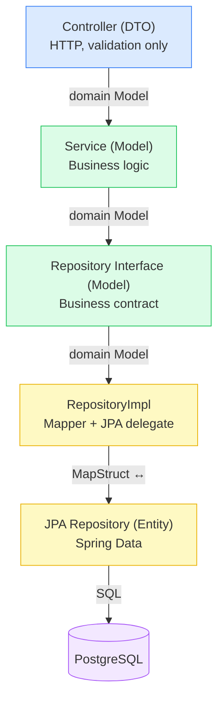

# Project Instructions

This file contains custom instructions for Claude Code CLI to help development
on the **StoreVision** project. Follow all rules strictly when generating,
modifying, or reviewing code.

---

## Core Stack

| Layer          | Technology                                                                     |
|----------------|--------------------------------------------------------------------------------|
| Language       | Java 25 (via Gradle toolchain: `JavaLanguageVersion.of(25)`)                   |
| Framework      | Spring Boot 4.0.6, Spring Modulith 2.0.6                                       |
| Data Access    | Spring Data JPA, Spring Data JDBC, Hibernate (PostgreSQL dialect)              |
| Database       | PostgreSQL (HikariCP connection pool, Liquibase 4.29.0 migrations)             |
| Security       | Spring Security + OAuth2 (Google provider), custom filter chain                |
| API Docs       | SpringDoc OpenAPI 3.0.2 / Swagger UI                                           |
| Templating     | Thymeleaf 3.x (with Spring Security extras)                                    |
| Batch          | Spring Batch                                                                   |
| Mapping        | MapStruct (Entity ↔ DTO conversions)                                           |
| Boilerplate    | Lombok (constructor properties + chaining accessors enabled via lombok.config) |
| Build Tool     | Gradle 9.4.1 (wrapper: `./gradlew`)                                            |
| Infrastructure | Docker / Docker Compose (PostgreSQL service via `compose.yaml`)                |
| Observability  | Spring Boot Actuator                                                           |
| i18n           | Spring MessageSource (`/i18n/messages` basenames, Vietnamese + English)        |

---

## Style & Engineering Principles

### 1. Package & Naming Conventions

- **Root package**: `com.nthn.storevision`
- **Sub-packages**: all lowercase, singular nouns (e.g., `controller`,
  `service`, `repository`, `entity`, `dto`, `mapper`, `config`, `exception`,
  `factory`, `util`)
- **Classes**: `PascalCase` (e.g., `OrderCreationService`, `CustomerMapper`)
- **Methods & variables**: `camelCase`
- **Constants**: `UPPER_SNAKE_CASE`
- **API versioning**: place versioned controllers under `controller/v1/` and
  name them `<Domain>ControllerV1`
- **Config/property keys**: `snake_case` (Jackson `SNAKE_CASE` naming strategy
  is project-wide)

### 2. Layered Architecture

Strictly follow the four-layer separation. Never skip a layer or mix concerns:

```
Controller (v1/)
    └── Service (operation-specific: Creation / Retrieval / Update / Deletion)
            └── Repository (interface + impl/ + jpa/)
                    └── Entity (entity/ + entity/mapped/)
```

- **Controllers**: Only handle HTTP concerns (request mapping, input validation
  via `@Valid`, status code declaration via `@ResponseStatus`). Delegate all
  logic to services. **Never wrap responses manually** — `ApiResponseHandler` (
  `advice/`) intercepts every non-`ResponseEntity` return value and wraps it in
  `ApiResponse` automatically.
- **Services**: One service class per operation per domain (e.g.,
  `OrderCreationService`, `OrderRetrievalService`). Implement generic interfaces
  from `service/generic/` (`Creatable`, `Readable`, `Updatable`, `Deletable`,
  `SoftDeletable`, `HardDeletable`).
- **Repositories**: Define interface in `repository/`, implementation in
  `repository/impl/`, Spring Data JPA repository in `repository/jpa/`.
  Repository methods **must return Entity types** (`Entity`, `Optional<Entity>`,
  `List<Entity>`, `Page<Entity>`) — never DTOs, never primitives constructed
  from projection queries unless explicitly using `@Query` projections for
  read-only optimization.
- **Entities**: Extend `BaseEntity` for all auditable entities. Never expose
  entities directly through API — always convert via Mapper. Entity-to-DTO
  conversion is the **exclusive responsibility of the Service layer**.

### 3. Service Design Rules

- Use **abstract base classes** in `service/common/` (`AbstractCreatable`,
  `AbstractReadable`) for shared behavior.
- Use **generic interfaces** in `service/generic/` for contract definition.
- **Controllers inject specific operation services directly** —
  `*CreationService`, `*RetrievalService`, `*UpdateService`, `*DeletionService`.
  Never inject the aggregator `*Service` (e.g., `ProductService`) into a
  controller.
- The aggregator `*ServiceImpl` exists for orchestration (e.g., cross-domain
  delegations) but is **not** the controller's entry point.
- Never call a `Repository` directly from a `Controller` or another `Service`'s
  domain.

#### Interface-Implementation pattern (mandatory for all service beans)

Every `@Service` bean must follow the Interface-Implementation split:

```
service/domain/
    XxxCreationService.java      ← interface, extends Creatable<E, I>
    XxxRetrievalService.java     ← interface, extends Readable<E, I>  (@NamedInterface if cross-module)
    XxxUpdateService.java        ← interface, extends Updatable<E>          (omit if domain has no update)
    XxxDeletionService.java      ← interface, extends SoftDeletable<E, I> & HardDeletable<E, I>  (omit if no delete)
    XxxService.java              ← aggregator interface — OPTIONAL; create only when cross-operation
    impl/                           orchestration is needed (e.g. ProductService delegates to all 4 ops)
        XxxCreationServiceImpl.java
        XxxRetrievalServiceImpl.java
        XxxUpdateServiceImpl.java   (omit if no update)
        XxxDeletionServiceImpl.java (omit if no delete)
        XxxServiceImpl.java         (omit if aggregator is not needed — see rule below)
```

**Aggregator rule**: only create `XxxService.java` + `XxxServiceImpl.java` when
the domain genuinely needs cross-operation orchestration. Domains that expose
only a subset of operations (e.g., Inventory with creation + retrieval only)
must **not** have an aggregator — the controller injects the two specific
services directly. Creating an aggregator for a domain that does not need it
adds indirection without value.

No concrete `@Service` class may live directly in `service/domain/` — only
interfaces belong there.

#### Deletion strategy

`XxxDeletionService` must implement **both** `SoftDeletable<E, I>` and
`HardDeletable<E, I>`:

| Method                  | When to call                                          | How it works                                                                                             |
|-------------------------|-------------------------------------------------------|----------------------------------------------------------------------------------------------------------|
| `markAsDeleted(id)`     | Default delete flow (called directly from controller) | Sets `entity.isDeleted = true`, saves → `CustomAuditingEntityListener` fills `deletedBy` / `deletedDate` |
| `restore(id)`           | Undo a soft delete                                    | Clears `deletedBy`, `deletedDate`, `isDeleted`; saves                                                    |
| `permanentlyDelete(id)` | Admin / compliance (GDPR) only                        | `repository.deleteById(id)` — physical removal                                                           |
| `delete(entity)`        | Inline soft delete via object                         | Sets `entity.isDeleted = true`, saves                                                                    |

**Business rules in specific service impls**: Pre-condition checks and warnings
tied to an operation (e.g., BR-P04: warn when soft-deleting a product that has
pending orders) must be implemented by **overriding the relevant method
in `*DeletionServiceImpl`** (or the appropriate `*OperationServiceImpl`), not in
the aggregator. The aggregator must remain a pure delegator.

```java
// correct — BR-P04 lives in ProductDeletionServiceImpl.markAsDeleted()
@Override
@Transactional
public void markAsDeleted(final Long id) {
    if (orderRetrievalService.existsPendingOrderForProduct(id)) {
        log.warn("BR-P04: product id {} has PENDING orders — soft-deleting anyway;...", id);
    }
    super.markAsDeleted(id);
}

// wrong — business rule buried in aggregator, invisible to direct callers
@Override
public void delete(final Long id) {
    if (orderRetrievalService.existsPendingOrderForProduct(id)) { ...}  // ❌
    deletionService.markAsDeleted(id);
}
```

### 4. DTO & Mapping Rules

- Always use **DTOs** (`dto/`) to expose data through the API — never JPA
  entities directly.
- Use **MapStruct** mappers (`mapper/`) for all entity ↔ DTO conversions. Do not
  write manual mapping code.
- API responses are wrapped automatically by `ApiResponseHandler` (a
  `ResponseBodyAdvice` in `advice/`) — controllers must return raw DTOs or
  `void`, **not** `ResponseEntity<>` or `ApiSuccessResponse<>`.
- `ApiResponseFactory` / `ApiErrorResponseFactory` are used internally by the
  advice layer — never inject them into controllers.
- Use `@ResponseStatus(HttpStatus.CREATED)` /
  `@ResponseStatus(HttpStatus.NO_CONTENT)` on controller methods to declare
  non-200 status codes without constructing `ResponseEntity`.

#### `@Schema` annotations on DTOs

- DTOs that are returned by (or accepted from) a controller endpoint **must**
  carry SpringDoc `@Schema` annotations — a class-level
  `@Schema(description = ...)` plus a per-field `@Schema(description = ...)` —
  so the Swagger UI at `/swagger-ui.html` stays accurate.
- DTOs, whose Javadoc starts with "Internal projection" — records used only to
  carry data from `Repository` to `Service` (or between private helper
  methods) and never returned from a controller — **must not** carry `@Schema`
  annotations or the `io.swagger.v3.oas.annotations.media.Schema` import. They
  are not part of the public API surface, so the annotations are dead weight.
- If a DTO's exposure changes (an internal projection starts being returned by
  a controller, or a previously exposed DTO becomes internal-only), add or
  remove its `@Schema` annotations to match.

```java
// correct — internal projection, never returned by a controller

/**
 * Internal projection: units of a product sold through COMPLETED orders (BR-A01) within a date
 * range. Used by the slow-moving and profit reports.
 */
public record ProductSalesDTO(Long productId, Long quantitySold) {
}

// correct — returned by AnalyticsControllerV1#getSlowMovingProducts
@Schema(description = "One row of the slow-moving products report.")
public record SlowMovingProductDTO(
        @Schema(description = "Product identifier") Long productId, ...) {
}
```

#### Repository → Service → Controller data flow (mandatory)

The conversion boundary between Entity and DTO is **always the Service layer**:

| Layer        | Returns                                                      | Never returns                                                       |
|--------------|--------------------------------------------------------------|---------------------------------------------------------------------|
| `Repository` | `Entity`, `Optional<Entity>`, `List<Entity>`, `Page<Entity>` | DTO, request/response objects                                       |
| `Service`    | `DTO`, `Optional<DTO>`, `List<DTO>`, `Page<DTO>`             | raw `Entity` (unless internal private helper within the same class) |
| `Controller` | raw `DTO`, `Page<DTO>`, or `void`                            | `Entity`, `ResponseEntity<>`, custom pagination wrapper DTOs        |

```java
// correct — Repository returns Entity
Optional<Customer> findById(Long id);   // CustomerRepository

// correct — Service converts Entity → DTO before returning
public CustomerDTO getById(Long id) {
    Customer entity = customerRepository.findById(id)
            .orElseThrow(() -> new EntityNotFoundException(...));
    return customerMapper.toDTO(entity);  // conversion happens here, in the service
}

// wrong — never return DTO from Repository
Optional<CustomerDTO> findById(Long id);  // ❌

// wrong — never return Entity from Service public API
public Customer getById(Long id) { ...}  // ❌ (exposes persistence detail to controller)
```

- Internal helper methods within a service implementation may pass domain
  objects between private methods, but must type them against the `model/`
  interface rather than the concrete `*Entity` (see *Entity vs. Model boundary*
  below) — the return-type rule applies to **public method signatures** on
  service interfaces.
- Cross-domain service calls (e.g., `OrderCreationService` calling
  `CustomerRetrievalService`) must use the **DTO** returned by the other
  domain's service — never reach into another domain's repository directly.

#### Entity vs. Model boundary (mandatory)

Concrete JPA entity types (`*Entity`, e.g. `ProductEntity`, `OrderEntity`) are a
**persistence detail** and may only be referenced by name in the `repository/`
(interface + `impl/` + `jpa/`), `entity/`, and `mapper/` layers. Every `*Entity`
implements a matching `model/` interface (`ProductEntity implements Product`,
`OrderEntity implements Order`, …), so all higher layers work through the
interface instead of the concrete class.

| Layer                                            | May name `*Entity` | Uses `model/` interface |
|--------------------------------------------------|:------------------:|:-----------------------:|
| `repository/` (interface, `impl/`, `jpa/`)       |         ✅          |            ✅            |
| `entity/`, `mapper/`                             |         ✅          |            ✅            |
| `service/`, `component/`, `util/`, `controller/` |         ❌          |            ✅            |

- In `service/`, `component/`, `util/`, and `controller/` code, declare every
  parameter, local variable, and return type against the `model/` interface
  (`Product`, `Order`, `OrderItem`, …) — never the concrete `*Entity`.
- A repository call still hands back a concrete `*Entity`; assign it to a
  `model/` interface reference immediately and pass that reference around.
- **Single exception**: a service impl that must build an entity to hand to
  `repository.save(...)` may name the concrete `*Entity` for that construction
  only — it is a persistence operation. The concrete type must not leak out of
  the class (never returned, never accepted on a public/interface signature).

```java
// correct — util programs against the Product model interface
public void verify(
        final List<? extends OrderItemCreationRequest> items,
        final Map<Long, ? extends Product> products) { ... }

// wrong — util names the concrete entity
public void verify(..., final Map<Long, ProductEntity> products) { ... }  // ❌
```

#### Pagination

- Use `org.springframework.data.domain.Page<T>` (the interface) directly as the
  return type for every paginated `*RetrievalService` method and the
  corresponding controller endpoint. **Never** create a custom pagination
  envelope DTO (e.g., a `PageDTO<T>` record) — Spring Data's Jackson
  `PageModule` already serializes `Page`/`PageImpl` into a stable
  `{content, page: {size, number, totalElements, totalPages}}` JSON envelope.
- In the service implementation, build the page with
  `repository.findXxx(PaginationUtil.toPageRequest(page, size, sort))` (returns
  `Page<Entity>`) and convert it with `.map(xxxMapper::toDTO)`, which returns
  `Page<DTO>` directly — no manual unwrapping or re-wrapping.
- The controller method returns the `Page<DTO>` from the service unchanged;
  `ApiResponseHandler` wraps it like any other return value.

```java
// correct — service
public Page<ProductDTO> findProductsPage(final int page, final int size, ...) {
    return getRepository()
            .searchActive(name, category, PaginationUtil.toPageRequest(page, size, DEFAULT_SORT))
            .map(productMapper::toDTO);
}

// correct — controller interface & impl
Page<ProductDTO> getAllProducts(int page, int size, String name, String category);

// wrong — custom pagination envelope
PageDTO<ProductDTO> getAllProducts(...);  // ❌
```

#### Mapper architecture (`mapper/`)

The mapper layer has two levels:

**1. `EntityMapper<T, I, E>` — generic base interface**

All domain mappers extend this interface. It defines three operations every
mapper must support:

| Method                                         | Direction             | Notes                                                                                                                                            |
|------------------------------------------------|-----------------------|--------------------------------------------------------------------------------------------------------------------------------------------------|
| `toDTO(E entity)`                              | Entity → DTO          | Used by service layer after persistence or retrieval                                                                                             |
| `toEntity(T dto)`                              | DTO → Entity          | Audit fields (`id`, `createdBy`, `createdDate`, `lastModifiedBy`, `lastModifiedDate`, `deletedBy`, `deletedDate`, `deleted`) are `ignore = true` |
| `updateEntity(T dto, @MappingTarget E entity)` | DTO → existing Entity | `id` is always `ignore = true`; other ignored fields are domain-specific                                                                         |

Abstract service classes (e.g., `AbstractCreatable`) depend on
`EntityMapper<T, ?, E>` directly — never on concrete mapper types.

**2. Domain mappers — thin `EntityMapper` extensions**

Each domain mapper extends `EntityMapper` and adds only domain-specific
`@Mapping` overrides. All domain mappers must declare
`config = BaseEntityMapperConfig.class`:

```java
// correct — minimal domain mapper
@Mapper(componentModel = MappingConstants.ComponentModel.SPRING, config = BaseEntityMapperConfig.class)
public interface CustomerMapper extends EntityMapper<CustomerDTO, Long, CustomerEntity> {
}

// correct — with domain-specific field mapping overrides
@Mapper(componentModel = MappingConstants.ComponentModel.SPRING, config = BaseEntityMapperConfig.class)
public interface OrderMapper extends EntityMapper<OrderDTO, Long, OrderEntity> {
    @Mapping(source = "customer.id", target = "customerId")
    OrderDTO toDTO(OrderEntity order);

    @Mapping(target = "customer", expression = "java(mapCustomerIdToCustomerEntity(dto.getCustomerId()))")
    OrderEntity toEntity(OrderDTO dto);
}
```

**3. `BaseEntityMapperConfig` — shared `@MapperConfig`**

`BaseEntityMapperConfig` (`mapper/`) is the single shared MapStruct config.
Every domain mapper must reference it via
`config = BaseEntityMapperConfig.class`. It provides:

- `unmappedTargetPolicy = IGNORE` — suppresses audit-field warnings for all
  DTO-based mappers
- A `toEntity(User)` prototype mapping — handles the `UserEntity ← User` edge
  case where `User` extends `CustomAuditable` with `Optional<User>` getters that
  MapStruct cannot auto-unwrap

Do **not** repeat `unmappedTargetPolicy = IGNORE` or the audit-field
`@Mapping(ignore = true)` block on individual domain mappers —
`BaseEntityMapperConfig` and `EntityMapper.toEntity()` already cover them.

### 5. Exception Handling

- Define all custom exceptions in the `exception/` package, extending
  `ApplicationException`.
- **Never throw a generic `RuntimeException`** — nor `Exception`, `Throwable`,
  or `Error`. The IntelliJ `ProhibitedExceptionThrown` inspection reports these
  as `Prohibited exception 'RuntimeException' thrown`. Throw a specific
  exception that extends `ApplicationException` (e.g. `EntityNotFoundException`,
  `InvalidOrderStateException`, `InsufficientStockException`) carrying a coded
  i18n message, so the global handler in `advice/` can map it to the correct
  HTTP status. This prohibits `throw new RuntimeException(...)` and wrapping a
  cause in a bare `RuntimeException`/`IllegalStateException`. **Rethrowing** an
  exception already caught in a `catch` block (`catch (final RuntimeException e)
  { log.error(...); throw e; }`) does not create a new prohibited exception and
  remains allowed.

```java
// wrong — throws a generic RuntimeException, flagged by ProhibitedExceptionThrown
if (order.getStatus() != OrderStatus.PENDING) {
    throw new RuntimeException("Order is not pending");   // ❌
}

// correct — throws a typed domain exception with a coded message
if (order.getStatus() != OrderStatus.PENDING) {
    throw new InvalidOrderStateException(orderId, order.getStatus());
}
```

- **Never** use `System.out.println()` for logging or error output.
- All exceptions must be caught and handled by the global exception handler in
  `advice/`.
- Use `EntityNotFoundException` for missing entities and `EntityAccessException`
  for authorization failures.
- Error messages must be externalized to `/i18n/messages` properties files to
  support i18n.

### 6. i18n Message Key Convention

All message keys in `/i18n/messages*.properties` must follow the
`[PREFIX][3-DIGIT-NUMBER]` format — never dot-notation (`product.not.found` is *
*wrong**).

#### Prefix registry

| Prefix | Domain                        | Example  |
|--------|-------------------------------|----------|
| `USM`  | User (`user`)                 | `USM001` |
| `PRM`  | Product (`product`)           | `PRM001` |
| `INM`  | Inventory (`inventory`)       | `INM001` |
| `AUM`  | Audit (`component/audit`)     | `AUM001` |
| `CSM`  | Customer (`customer`)         | `CSM001` |
| `EMM`  | Employee (`employee`)         | `EMM001` |
| `ORM`  | Order (`order`)               | `ORM001` |
| `OIM`  | Order item (`orderitem`)      | `OIM001` |
| `VCM`  | Voucher (`voucher`)           | `VCM001` |
| `ANM`  | Analytics (`analytics`)       | `ANM001` |
| `NOM`  | Notification (`notification`) | `NOM001` |

> When adding a new domain, register its prefix in this table before writing any
> message keys.

#### Rules

- **Constants file**: every domain must have a `{Domain}MessageCodes` enum in
  `constant/` whose `static final String` fields reference the code string (e.g.
  `public static final String NOT_FOUND = "PRM001"`). Never inline the string in
  business code.
- **Bean Validation messages**: validation constraint messages in DTOs must also
  use the coded format — `@NotBlank(message = "{PRM003}")`, not
  `@NotBlank(message = "Product name is required")`.
- **Numbering**: allocate codes sequentially per prefix. The first code is
  `001`. Leave no gaps.
- **All locales**: every code added to `messages.properties` (EN base) must also
  be added to `messages-vi.properties` (VI).
- **Parameter placeholders**: use bare `{0}`, `{1}` for dynamic values — never
  surround with escaped single quotes (`''{0}''`). MessageFormat's `''{n}''`
  pattern emits literal quotes around the value, which is almost never desired.
  Use `'{n}'` only when you need to display a literal `{n}` string (no
  substitution).

#### Current code allocation

| Code     | Meaning                                               |
|----------|-------------------------------------------------------|
| `USM001` | User not found                                        |
| `PRM001` | Product not found                                     |
| `PRM002` | Product name + category already exists (BR-P01)       |
| `PRM003` | Product name required                                 |
| `PRM004` | Product price required                                |
| `PRM005` | Product price must be > 0                             |
| `PRM006` | Stock quantity required                               |
| `PRM007` | Stock quantity must be >= 0                           |
| `INM001` | Product ID required (StockReceiptRequest)             |
| `INM002` | Quantity required (StockReceiptRequest)               |
| `INM003` | Quantity must be >= 1 (BR-I02)                        |
| `INM004` | Unit cost must be >= 0                                |
| `INM005` | No authenticated user found for performed_by (BR-I01) |
| `AUM001` | Failed to set annotated audit field                   |
| `AUM002` | No setter found for audit field                       |
| `AUM003` | Failed to invoke setter for audit field               |
| `CSM001` | Customer not found                                    |
| `CSM002` | Customer email already exists (BR-C01)                |
| `CSM003` | Customer has pending orders, cannot delete (BR-C02)   |
| `CSM004` | Insufficient loyalty points (BR-C03)                  |
| `CSM005` | Points required (RedeemPointsRequest)                 |
| `CSM006` | Points must be >= 1                                   |
| `CSM007` | Customer name required                                |
| `CSM008` | Customer email required                               |
| `CSM009` | Customer email invalid                                |
| `EMM001` | Employee not found                                    |
| `ORM001` | Order not found                                       |
| `ORM002` | Customer ID required (OrderCreationRequest)           |
| `ORM003` | Order must contain at least one item (BR-O05)         |
| `ORM004` | Insufficient stock for order item (BR-O01)            |
| `ORM005` | Order channel required (OrderCreationRequest)         |
| `ORM006` | Order not in PENDING state for transition (BR-O02)    |
| `OIM001` | Order item not found                                  |
| `OIM002` | Product ID required (OrderItemCreationRequest)        |
| `OIM003` | Quantity required (OrderItemCreationRequest)          |
| `OIM004` | Quantity must be >= 1                                 |
| `VCM001` | Voucher not found                                     |
| `VCM002` | Voucher expired (BR-V01)                              |
| `VCM003` | Voucher inactive (BR-V02)                             |
| `VCM004` | Voucher usage limit reached (BR-V03)                  |
| `VCM005` | Order amount below voucher minimum (BR-V04)           |
| `ANM001` | Invalid reporting date range (BR-A02)                 |
| `NOM001` | Notification not found                                |

### 7. Logging

- Use **SLF4J** (`@Slf4j` from Lombok) exclusively for all logging. Never use
  `System.out.println` or `printStackTrace()`.
- Log at the correct level: `DEBUG` for service/logic flow, `INFO` for
  significant state changes, `WARN` for recoverable issues, `ERROR` for
  exceptions.
- Always use **parameterized logging** — never string concatenation:
  ```java
  // correct
  log.debug("Fetching customer id: {}", id);
  // wrong — allocates string even when log level is disabled
  log.debug("Fetching customer id: " + id);
  ```
- Pass the **exception object as the final argument** when logging errors to
  preserve the full stack trace:
  ```java
  // correct — SLF4J renders the stack trace automatically
  log.error("Failed to process entity: {}", entity, exception);
  // wrong — stack trace is lost
  log.error("Failed to process entity: " + exception.getMessage());
  ```
- Refer to `application-logging.yml`: project package `com.nthn` logs at
  `DEBUG`, root at `INFO`.

### 8. Security Rules

- Security configuration lives exclusively in `SecurityConfig.java` under
  `security/config/`.
- The `security/` package is structured into focused sub-packages: `config/` (
  SecurityConfig), `context/` (UserContext), `filter/` (UserInfoFilter),
  `oauth/` (OAuth2SuccessHandler), `user/` (CustomUserDetailsService,
  UserPrincipal).
- OAuth2 Google authentication is configured in
  `application-authentication.yml` — do not hardcode credentials.
- Never expose internal user/session data outside the `security/` boundary
  without going through `UserContext` in `security/context/`.
- Keep security-related components (JWT provider, custom filters, authentication
  configuration) isolated inside the `security/` sub-package hierarchy — never
  scatter them into generic packages such as `component/` or the top-level
  `config/`.

### 9. Database & Migrations

- **All schema changes** must be applied via **Liquibase** changesets — never
  modify the database schema directly or use
  `spring.jpa.hibernate.ddl-auto=update/create`.
- Connection pool settings (`max-pool-size`, `connection-timeout`) are
  externalized via environment variables (`${DATASOURCE_MAX_POOL_SIZE}`,
  `${DATASOURCE_URL}`).
- Use **soft delete** (via `deleted_by` / `deleted_date` audit fields on
  `BaseEntity`) unless a hard delete is explicitly required by business logic.

#### Liquibase changeset SQL convention

- Changeset SQL files live under `src/main/resources/db/changeset/v{version}/`
  and rollback files under `src/main/resources/db/rollback/v{version}/`.
- **All SQL inside changeset and rollback files must be wrapped in a PostgreSQL
  anonymous block:**
  ```sql
  DO
  $$
      BEGIN
          -- DDL here (CREATE TABLE, CREATE INDEX, DROP TABLE, DROP INDEX…)
      END
  $$;
  ```
- Master changelog (`db/changelog/db.changelog-master.xml`) uses `<changeSet>`
  with `<sqlFile>` and `<rollback><sqlFile>` — never inline `<sql>` blocks,
  never `<include>`.
- Each `<changeSet>` must carry a `labels="v{version}"` attribute matching its
  folder version.
- File naming: `{NNN}-{action}-{table}-table.sql` /
  `{NNN}-{action}-{table}-table-rollback.sql`.

### 10. Auditing

- All entities must extend `BaseEntity` which provides `createdBy`,
  `createdDate`, `lastModifiedBy`, `lastModifiedDate`, `deletedBy`,
  `deletedDate`.
- The `CustomAuditingEntityListener` and `UserAuditorAware` in
  `component/audit/` handle automatic population — do not set these fields
  manually.
- Use `@DeletedBy` / `@DeletedDate` annotations (from `annotation/`) for soft
  delete fields.

#### Soft delete trigger mechanism

`BaseEntity` has `@Transient boolean isDeleted`. The
`CustomAuditingEntityListener` fires on `@PreUpdate` and, when
`isDeleted == true && deletedDate.isEmpty()`, automatically sets `deletedBy` and
`deletedDate` via reflection. **Never set these two fields directly** — always
go through `entity.setDeleted(true)` + `repository.save(entity)`.

To restore: call `entity.setDeletedBy(null)`, `entity.setDeletedDate(null)`,
`entity.setDeleted(false)`, then `repository.save(entity)`. The listener will
skip the soft-delete block (because `isDeleted == false`) and only update
`lastModifiedBy` / `lastModifiedDate`.

### 11. API Documentation

- All controllers and endpoints must include **SpringDoc/OpenAPI annotations**
  so the Swagger UI at `/swagger-ui.html` stays accurate.
- API base path: `/` (at the root)
- Swagger config: `application-swagger.yml` — do not duplicate configuration
  elsewhere.
- **Base request-mapping paths** (
  `@RequestMapping(value = ..., version = "v1")`)
  must reference a `public static final String` constant from
  `constant/api/EndpointDefinitions` (e.g., `EndpointDefinitions.CUSTOMERS =
  "/customers"`) — never hardcode the path literal. `EndpointDefinitions` is a
  flat enum of plain string constants (no instances, `;`-only body) used
  directly by both the controller's `@RequestMapping(value = ...)` and the
  corresponding `SecurityConfig` request matchers, so the controller's base
  path and its security matcher can never drift apart. When adding a new
  domain, register its path constant (and an `_ALL` wildcard variant if
  `SecurityConfig` needs one) in `EndpointDefinitions`, in alphabetical order,
  before writing any controller code.

#### Controller Interface-Implementation pattern

```
controller/
    XxxController.java          ← version-agnostic interface (contract only)
    v1/
        XxxControllerV1.java    ← @RestController, @RequestMapping(value = EndpointDefinitions.XXX, version = "v1")
```

**Controller interface rules (`XxxController.java`):**

| Element                                                 | Allowed | Notes                                      |
|---------------------------------------------------------|---------|--------------------------------------------|
| Method signatures                                       | ✅       | All public endpoint methods                |
| `@Valid` on DTO params                                  | ✅       | Validation is part of the domain contract  |
| Javadoc + `@see XxxControllerV1`                        | ✅       | Document the contract, link to impl        |
| `@RequestMapping`, `@GetMapping`, `@PostMapping`, etc.  | ❌       | HTTP routing belongs in the versioned impl |
| `@RequestBody`, `@PathVariable`                         | ❌       | Spring MVC binding belongs in impl         |
| `@Tag`, `@Operation`, `@ApiResponse`, `@Parameter`      | ❌       | OpenAPI docs belong in impl                |
| `@RestController`, `@Slf4j`, `@RequiredArgsConstructor` | ❌       | Spring bean annotations belong in impl     |

```java
// controller/CustomerController.java — correct
public interface CustomerController {
    CustomerDTO createCustomer(@Valid CustomerDTO dto);   // @Valid ✅, raw DTO return ✅

    void deleteCustomer(Long id);

    List<CustomerDTO> getAllCustomers();

    CustomerDTO getCustomerById(Long id);

    CustomerDTO updateCustomer(Long id, @Valid CustomerDTO dto);
}

// controller/v1/CustomerControllerV1.java — implementation
@ResponseStatus(HttpStatus.CREATED)  // sets 201 without ResponseEntity
@PostMapping
@Override
public CustomerDTO createCustomer(@Valid @RequestBody final CustomerDTO dto) {
    return customerService.create(dto);  // ApiResponseHandler wraps this automatically
}
```

#### Required OpenAPI annotations on the implementation class

| Annotation                                | Scope                 | Notes                                                                    |
|-------------------------------------------|-----------------------|--------------------------------------------------------------------------|
| `@Tag(name, description)`                 | Class                 | One tag per controller                                                   |
| `@Operation(summary, description)`        | Method                | `summary` = one-liner; `description` = field constraints, business rules |
| `@ApiResponse(responseCode, description)` | Method                | Use directly (repeatable) — do **not** wrap in `@ApiResponses`           |
| `@Parameter(description)`                 | `@PathVariable` param | Place on the parameter itself, not in `@Operation`                       |

#### String constants for annotation values

All string literals used in OpenAPI annotations must be defined as compile-time
constants — never inline strings, and never as `private static final String`
fields in a controller class:

- **HTTP response codes** (e.g., `"200"`, `"409"`) → `constant/api/ResponseCode`
- **Every `@ApiResponse(description = ...)` string** → `public static final
  String` in `constant/api/ResponseDescription`. This includes generic
  descriptions (e.g., `"Resource not found"`) **and** operation-/business-rule-specific descriptions unique to a single
  controller (e.g., a conflict
  message for BR-P01). There is no "controller-local" exception — all of these
  live in `ResponseDescription`, in alphabetical order.
- **Every `@Parameter(description = ...)` string** → `public static final
  String` in `constant/api/ParameterDescription`. This includes domain ID
  descriptions (e.g., `"Product ID"`, `"Order ID"`), pagination parameters
  (`PAGE_INDEX`, `PAGE_SIZE`), and any other request-parameter description, in
  alphabetical order.
- **Every `@RequestParam(defaultValue = ...)` string** → `public static final
  String` in `constant/api/DefaultRequestParam` (e.g., `DEFAULT_PAGE = "0"`,
  `DEFAULT_SIZE = "20"`), in alphabetical order. Keep these separate from
  `PaginationUtil`/other helper classes — `@RequestParam(defaultValue = ...)`
  requires a genuine compile-time constant `String`, which a
  `DefaultRequestParam` enum constant guarantees.
- **Every `@Operation(description = ...)` string** → `public static final
  String` in `constant/api/OperationDescription`. Each constant carries its own
  Javadoc block that documents the operation's behavior and the business rules
  it enforces in prose; the constant's string value itself stays terse and
  Swagger-facing. `@Operation(summary = ...)` is a short one-liner and stays
  inline as a string literal — it is not extracted to either constant class.

```java
// correct — domain ID uses ParameterDescription constant
@Parameter(description = ParameterDescription.PRODUCT_ID)
@PathVariable
final Long id

// correct — pagination parameter description + default value use their
// respective constants classes
@Parameter(description = ParameterDescription.PAGE_INDEX)
@RequestParam(defaultValue = DefaultRequestParam.DEFAULT_PAGE)
final int page

// correct — operation-/business-rule-specific description lives in ResponseDescription
@ApiResponse(
        responseCode = ResponseCode.CONFLICT,
        description = ResponseDescription.PRODUCT_NAME_EXISTS_IN_CATEGORY)

// correct — long-form @Operation description lives in OperationDescription,
// summary stays inline as a short literal
@Operation(
        summary = "Soft-delete a customer by ID",
        description = OperationDescription.CUSTOMER_DELETION)

// wrong — inline strings flagged by linter as duplicates
@Parameter(description = "Product ID")
@PathVariable
final Long id   // ❌
@ApiResponse(responseCode = "409", description = "Conflict")          // ❌
@RequestParam(defaultValue = "0")
final int page                      // ❌

// wrong — no private constants in controllers, not even for one-off descriptions
private static final String CONFLICT_DESC = "Product name already exists in the same category"; // ❌
```

**Registering a new constant**:

- `ResponseDescription` — when adding a new domain (e.g., `Supplier`) or a new
  endpoint that needs its own `@ApiResponse` description, add the corresponding
  `public static final String` constant, in alphabetical order, before writing
  any controller code.
- `ParameterDescription` — when adding a new domain ID (e.g.,
  `SUPPLIER_ID = "Supplier ID"`) or any other new `@Parameter` description, add
  the corresponding `public static final String` constant, in alphabetical
  order, before writing any controller code.
- `DefaultRequestParam` — when an endpoint needs a new
  `@RequestParam(defaultValue = ...)`, add the corresponding
  `public static final String` constant, in alphabetical order, before writing
  any controller code.
- `OperationDescription` — when an endpoint's `@Operation(description = ...)`
  documents non-trivial behavior or business rules, add a new
  `public static final String` constant with a Javadoc block describing the
  operation, in alphabetical order, before writing any controller code.

### 12. Modulith Boundaries

- This project uses **Spring Modulith**. Use `@NamedInterface` to declare
  explicit module boundaries.
- Do not create cross-module dependencies that bypass the declared interfaces.
- Run `ApplicationModularityTests` to verify module structure before merging
  changes.

### 13. Testing Standards

- **Mandatory**: write unit tests for all service-layer logic using **JUnit 5
  ** (Jupiter) and **Spring Boot Test**.
- Security-related tests must use **Spring Security Test** (`@WithMockUser`,
  `SecurityMockMvcRequestPostProcessors`).
- Batch jobs must be tested with **Spring Batch Test**.
- Minimum code coverage target: **80%** for service layer classes.
- Test classes mirror the source package structure under
  `src/test/java/com/nthn/storevision/` — including the `impl/` sub-package. A
  test for `service/product/impl/ProductServiceImpl` lives at
  `test/java/.../service/product/impl/ProductServiceImplTest`.
- Test class names use the `<ClassName>Test` suffix matching the implementation
  class, not the interface (e.g., `ProductServiceImplTest`, not
  `ProductServiceTest`).
- Use Spring's `@DataJpaTest` (or `@JdbcTest`) for repository layer tests — do
  not spin up the full application context for persistence tests.
- Do **not** use mocked databases when integration behavior is under test;
  prefer the real PostgreSQL via `compose.yaml`.

### 14. Code Quality Rules

- **No raw `System.out` or `printStackTrace()`** anywhere in the codebase.
- **No magic strings or numbers** — externalize to constants in `constant/` or
  message properties in `i18n/`.
- Use constructor injection (Lombok `@RequiredArgsConstructor`) — never field
  injection (`@Autowired` on fields).
- Prefer `Optional<T>` over `null` returns in service and repository methods.
- Validate all incoming request bodies with Bean Validation (`@Valid`,
  `@NotNull`, `@NotBlank`, etc.) at the controller boundary.
- Factory classes in `factory/` must be used for constructing response objects —
  do not construct `ApiResponse` subclasses inline.
- **Lambda body length**: the IntelliJ `OverlyLongLambda` inspection (enabled at
  the `WARNING` level in `.idea/inspectionProfiles/Project_Default.xml`) limits a
  lambda body to **3 non-comment statements**. A body of 4+ statements is
  flagged. Keep lambdas to a single expression where possible; when the body
  grows past the limit, **extract it into a named `private` method** and have the
  lambda delegate to that method. Do not silence the inspection.

```java
// wrong — 4-statement lambda body, flagged by OverlyLongLambda
requestedPerProduct.forEach(
    (productId, requested) -> {
        final Product product = products.get(productId);
        if (product.getStockQuantity() < requested) {
            log.warn("Insufficient stock for product id={}", productId);
            throw new InsufficientStockException(product.getName(), product.getStockQuantity(), requested);
        }
    });  // ❌

// correct — lambda delegates to an extracted private method
requestedPerProduct.forEach(
    (productId, requested) -> verifyProductStock(productId, products.get(productId), requested));

private void verifyProductStock(final Long productId, final Product product, final int requested) {
    if (product.getStockQuantity() >= requested) {
        return;
    }
    log.warn("Insufficient stock for product id={}", productId);
    throw new InsufficientStockException(product.getName(), product.getStockQuantity(), requested);
}
```

### 15. Javadoc Requirements

Every **public** method on any `interface` or `public class` must have a Javadoc
comment. This is enforced by the project's checkstyle/linter configuration.

#### Mandatory elements

| Element                    | Required tags                                                                                                           |
|----------------------------|-------------------------------------------------------------------------------------------------------------------------|
| Interface method           | `@param` for every parameter, `@return` unless `void`                                                                   |
| `model/` interface methods | Same as above; setters must also document valid/invalid values (e.g., `null` policy) and return `{@code Self}` instance |
| Class-level Javadoc        | Required on every `public` class, interface, and enum                                                                   |
| Enum constants             | Required on every constant if the enum is part of the public API                                                        |

#### Style rules

- The first sentence is the summary — keep it under 120 characters.
- Use `{@link ClassName}` for type references; `{@code value}` for literal
  values.
- Do **not** write trivial "Gets the X" / "Sets the X" Javadocs that add no
  information — but do include `@param` and `@return` even when the summary is
  minimal.
- Describe the **null policy** for every parameter and return value: either "must not be {@code null}" or "may be {@code
  null}; returns/accepts null if …".

---

## Code Review Checklist (Mandatory)

Every new piece of code and every MR must satisfy the entire checklist below before
it can be approved. This is the team's general backend review standard — Claude Code
must self-check it before committing and when reviewing an MR (in combination with the
review process described in this document).
Items that already have their own detailed rules link back to the corresponding section.

### 1. Architecture & Design

- Strict layering Controller → Service → Repository, **never skip a layer**
  (see *Layered Architecture*).
- The Controller **must not** contain business logic (see controller responsibilities in *Layered Architecture*).
- **Do not** use a JPA Entity as a DTO returned from the API — the Entity must not leave `repository/`.
- Follow SOLID, DRY, KISS; remove duplication via abstraction/strategy
  (e.g., operation-specific services + shared abstract bases in `service/common/`).
- **No** circular dependencies between modules/packages.

### 2. Code Quality & Conventions

- Variable/method/class names are clear, follow Java standards and the project's *Naming Conventions*.
- Code has been run through the formatter (Spotless/Google Java Format) before committing.
- **No** dead code, redundant comments, junk debug logs (stray `log.debug`), or dangling `TODO`s.
- **No** hardcoding — extract into `constants/` (`*Constants`) or config; **no** magic numbers in logic.
- Static analysis (Sonar/Checkstyle/PMD) has **no** remaining blocker/critical issues;
  Checkstyle build-breaking rules must pass (see *Checkstyle*).

### 3. Java Core Best Practices

- Avoid NPE: use `Optional` or `@NonNull`/`@Nullable` (see *Null Safety* —
  `ReturnNull` at the ERROR level).
- **Do not** use `Optional` for object fields (only for return types).
- Use `BigDecimal` for all monetary processing — **do not** use `double`/`float`.
- Use `java.time` (`Instant`, `LocalDateTime`…) — **do not** use the legacy `Date`/`Calendar`.
- Complete exception handling, **never swallow exceptions**; **no** `catch (Throwable)`
  (see *Exception Handling*).
- **Do not** overuse Streams in a way that hurts readability/performance; lambdas ≤ 17 statements.

### 4. API (REST)

- Conform to RESTful standards + correct HTTP method; accurate status codes (e.g. `204` for
  an empty `Optional`/`Page`).
- Validate input with `@Valid` + Bean Validation constraints on the DTO.
- Responses are unified through the internal standard (`ApiResponseHandler` with `ApiResponse` wrapper types).
- Errors always return a JSON error object via the global `@RestControllerAdvice` — **never** return HTML.
- Pagination **must** cap the maximum `size` (to prevent overload requests).
- Update Swagger/OpenAPI (`@Operation`, `@ApiResponse`, `@Schema`) for every API change.

### 5. Spring Boot

- **Constructor injection** via `@RequiredArgsConstructor` — field `@Autowired` is forbidden
  (see *Dependency Injection*).
- Externalize configuration in `application*.yml` per environment; use env vars.
- **Absolutely never** commit secrets/tokens/passwords in code or config.
- Centralized error handling via `@RestControllerAdvice`.
- Place `@Transactional` at the correct layer (Service) and with the correct scope; be careful with readOnly.
- Standard SLF4J logging (`@Slf4j`) — **no** `System.out.println`; no `[ClassName]`
  prefix (see *Logging*).

### 6. JPA / Hibernate / Database

- Clear Entity mapping: `nullable`, `length`, `unique`, column types.
- Minimize `FetchType.EAGER` — default to `LAZY`.
- Check for and avoid **N+1 queries** (use `@EntityGraph`/`JOIN FETCH` when needed).
- Queries use **parameter binding**, **never** string concatenation → prevents SQL injection.
- **Do not** perform DB operations inside loops — use batch/bulk.
- Schema changes must come with complete migration scripts (Flyway/Liquibase);
  note `HIBERNATE_DDL_AUTO=validate`.
- Add indexes for columns frequently used in filters/joins.

### 7. Security

- **Never** log sensitive data (passwords, tokens, OTPs, JWTs, PII).
- Use HTTPS in production; CORS **must not** be `*` in production.
- Tokens/JWTs must have expiry (`exp`) — never unlimited.
- Validate input against XSS/Injection; use standard secure coding checks and dependency scanning where relevant.
- Protect endpoints with `@PreAuthorize` and role-based rules from Spring Security configuration.
- Store keys/secrets via a secret manager/env — never in source.

### 8. Performance

- **Do not** load a full table when pagination is possible.
- Optimize queries: limit `LIKE '%...%'` leading wildcards, `ORDER BY` on non-indexed columns.
- Clear cache strategy (key, TTL, invalidation); when caching is introduced, define clear invalidation with Spring Cache annotations.
- **Do not** block threads unnecessarily in concurrent/background workloads.
- Limit creating new objects in code that runs frequently (hot path).

### 9. Logging & Observability

- Correct log levels: `INFO` for data-mutating ops (with structured fields), `DEBUG` for detail,
  `ERROR` for real errors.
- Attach a Request ID / Correlation ID (MDC) when available and keep it consistent across request processing.
- Log thoroughly when calling external services (OAuth providers, third-party APIs, infrastructure dependencies).
- **Never** log sensitive data.
- Monitor healthcheck/metrics via Spring Boot Actuator.

### 10. Testing

- Unit tests (`./gradlew test`, `test` profile, Mockito) cover the main logic;
  name them `methodName_givenCondition_thenExpectedOutcome`.
- Repository/Controller tests via integration tests (`./gradlew integrationTest`) +
  Testcontainers (real PostgreSQL).
- Cover both the happy case and edge cases.
- Tests **must not** depend on the environment or system clock (inject a `Clock` when time is needed).
- Mock external services (WireMock or Mockito) — never call real services.
- Coverage meets the team's required threshold.

### 11. CI/CD & Deployment

- Reproducible build, clear versioning.
- Scan dependency vulnerabilities.
- Multi-stage Dockerfile, optimized layers.
- Containers **must not** run as root.
- Declare all required env variables when deploying (see *Environment Variables*).
- Have a rollback strategy for failed deployments.

---

## Documentation Conventions (Mandatory)

Every code change must come with the corresponding technical documentation file in `docs/`.
Claude Code must create the doc file **before** creating the commit for a feature or bug fix.

### `docs/` Directory Structure

Every documentation file **must** reside in exactly one of the directories below. **Do not**
leave a loose `.md` file directly at `docs/` (root) — always pick the appropriate directory.

```
docs/
├── features/<ticket-id>/   # Feature/enhancement docs (tied to a Jira ticket)
│   └── technical-doc.md
├── fix/<ticket-id>/        # Bug fix docs (tied to a Jira ticket)
│   └── root-cause.md
├── refactoring/<slug>/     # Refactor docs (descriptive slug, or <ticket-id> if available)
│   └── refactor-doc.md
├── api/<category>/         # REST/WS endpoint docs, grouped by domain
│                           # (analytics, session, provider, quota, streaming…)
├── architecture/           # Internal overall design notes (NOT tied to a ticket)
├── guides/                 # How-to, integration guides, reference docs,
│                           # status reports — docs NOT tied to a specific ticket
└── reference/              # Spec/protocol reference (e.g. MCP protocol, JSON-RPC)
```

### File Location and Naming

| Documentation Type                      | Directory                    | Required File Name      |
|-----------------------------------------|------------------------------|-------------------------|
| New feature / enhancement (with ticket) | `docs/features/<ticket-id>/` | `technical-doc.md`      |
| Bug fix (with ticket)                   | `docs/fix/<ticket-id>/`      | `root-cause.md`         |
| Refactor (with or without ticket)       | `docs/refactoring/<slug>/`   | `refactor-doc.md`       |
| REST/WebSocket endpoint doc             | `docs/api/<category>/`       | `<METHOD>_<path>.md`    |
| Overall architecture note               | `docs/architecture/`         | `<kebab-case-title>.md` |
| How-to / integration / status report    | `docs/guides/`               | `<kebab-case-title>.md` |
| Spec / protocol reference               | `docs/reference/`            | `<kebab-case-title>.md` |

`<ticket-id>` is the Jira ticket code, e.g. `PQF-20402`, `PQF-20178`.
The `features/` and `fix/` directories **require** a `<ticket-id>`; if a document is not tied
to a specific ticket (guide, reference, general architecture) → place it in `guides/`,
`reference/`, or `architecture/`, and **do not** stuff it into `features/`/`fix/` with a made-up name.

`refactoring/` specifically allows a kebab-case **`<slug>`** describing the refactor scope
(e.g. `refactor-exception-advice`) when there is no ticket; if the refactor is tied to a ticket,
use the `<ticket-id>` as the directory name. Each subdirectory contains exactly one `refactor-doc.md`.

**Correct examples:**

```
docs/features/PQF-20100/technical-doc.md
docs/fix/PQF-20402/root-cause.md
docs/refactoring/refactor-exception-advice/refactor-doc.md
docs/refactoring/PQF-21500/refactor-doc.md
docs/api/session/POST_sessions_initialize.md
docs/architecture/streaming-service.md
docs/guides/ollama-basic-auth.md
docs/reference/mcp-protocol.md
```

**Not acceptable:**

```
docs/my-feature.md                             ← loose file at root, no directory
docs/features/my-feature.md                    ← missing ticket-id
docs/features/dynamic-prompt-templates.md      ← doc not tied to a ticket → must go in guides/
docs/fix/PQF-20402/solution.md                 ← wrong file name
docs/fix/PQF-20402/root-cause-and-solution.md  ← wrong file name
docs/refactoring/foo.md                        ← missing subdirectory + wrong file name
docs/refactoring/foo/technical-doc.md          ← wrong file name (must be refactor-doc.md)
```

---

### Required Structure — `technical-doc.md`

```markdown
# <Ticket-ID> – <Feature Title>

## Overview

A short description of what the feature does and why it needs to be built.

## Background

Context, motivation, related tickets.

## Technical Design

### Architecture / Data Flow

### Component Changes

List each changed file: full path and description of the change.

## API Changes

New or changed endpoints — method, path, request/response schema.

## Database Changes

New schema, added columns, migration script.

## Implementation Notes

Non-obvious decisions, tradeoffs, workarounds.

## Testing

Unit test and integration test coverage for this feature.

## Rollout

Feature flag, phased rollout, backward-compatibility.
```

---

### Required Structure — `root-cause.md`

```markdown
# <Ticket-ID> – <Bug Title>

## Bug Description

Incorrect behavior, reproduction steps affected the environment.

## Root Cause

A step-by-step analysis of why the bug occurs.
Include: file paths, method names, illustrative code snippets.

## Fix

### Changes Made

Describe each changed file and the reason for the change.

## Testing

How to confirm the fix is correct — manual steps and/or test case names.

## Summary

| # | File | Problem | Fix |
|---|------|---------|-----|
```

---

### Required Structure — `refactor-doc.md`

```markdown
# <Slug | Ticket-ID> – <Refactor Title>

## Motivation

The reason for refactoring: technical debt, architecture violations, duplication, performance…
Behavior **does not** change — state clearly that this is a refactored, not a feature/fix.

## Scope

The affected scope: related modules/packages/classes; what is NOT in the scope.

## Before / After

Compare the structure before and after (diagram, illustrative code snippet, or comparison table).

## Changes Made

List each changed file: full path and description of the change.

## Risk & Compatibility

Risks, breaking changes (if any), backward-compatibility, how to roll back.

## Testing

Evidence that behavior is unchanged: existing tests still pass, additional tests (if any).
```

---

### Enforcement Rules

- A PR missing the corresponding doc file → **cannot be approved**.
- Claude Code must create the doc file **at the same time** as the code change, not afterward.
- If a single change affects multiple tickets, each ticket must have its own file.
- You must not add doc content to another file (e.g., writing into `architecture/`)
  as a substitute for the required file.

---

## Code Style & Architecture Guidelines

### Layer Architecture (Strict — Never Skip Layers)



- **Controllers** handle HTTP concerns and DTO validation only. Zero business
  logic.
- **Services** operate exclusively on domain models (`model/`). Never touch JPA
  entities.
- **RepositoryImpl** is the only layer allowed to reference JPA entities and
  call JPA repositories.
- **Never** inject `Jpa*Repository` directly into a Service. Always go through
  the business interface.
- **Never** expose JPA entities outside the `repository/` layer.

### Controller Pattern — Interface Contract + Versioned Impl (Mandatory)

Every REST controller must be split into **2 files**: an interface defining the
contract and a versioned implementation. This is the project's standard pattern —
refer to the pairs `QuotaController` / `QuotaControllerV1` and
`DashboardAnalyticsController` / `DashboardAnalyticsControllerV1`.

| File               | Location                                | Responsibility                                                                                                                             |
|--------------------|-----------------------------------------|--------------------------------------------------------------------------------------------------------------------------------------------|
| **Interface**      | `controller/<Name>Controller.java`      | Declares the contract: method signatures + **complete Javadoc** (description, `@param`, `@return`). No Spring/Swagger annotations.         |
| **Implementation** | `controller/v1/<Name>ControllerV1.java` | `implements <Name>Controller`. Contains all HTTP, security, Swagger, and rate-limit annotations plus thin logic delegating to the Service. |

**Rules for the Interface (`controller/<Name>Controller.java`):**

- It is a plain `public interface`, placed directly in the `controller/` package (not `v1/`).
- Every method **must** have Javadoc describing its behavior, including `@param` for
  each parameter and `@return` describing the response.
- Parameters that may be `null` must be annotated `@Nullable` (following the general Null Safety rules).
- Annotate the interface with `@SuppressWarnings("unused")` because methods are invoked over HTTP,
  not through a Java call-site.
- **Do not** place Spring annotations (`@GetMapping`, `@PreAuthorize`, …) or Swagger
  annotations (`@Operation`, `@ApiResponse`) on the interface — they belong to the impl.

**Rules for the Implementation (`controller/v1/<Name>ControllerV1.java`):**

- Class name `<Name>ControllerV1`, placed in `controller/v1/`, `implements <Name>Controller`.
- Class-level: `@RestController`, `@RequestMapping(EndpointCategory.BasePath.*)`,
  `@Tag`, `@SecurityRequirement(name = OpenApiConfig.BEARER_AUTH)`,
  `@RequiredArgsConstructor`, `@Slf4j`.
- DI via **constructor injection** (`@RequiredArgsConstructor` + `private final`) —
  no `@Autowired` fields.
- Every overriding method **must** have `@Override` and the full set of annotations in this order:
  `@Operation` → `@ApiResponse` (the various codes) → `@GetMapping`/`@PostMapping`/… (using constants
  from `ApiEndpoint.Path`) → `@PreAuthorize("hasPrivilege(...)")` (constants from `McpPrivilege.Constants`)
  → `@RateLimited` → `@Override`.
- The Controller only handles HTTP + DTO validation (`@Valid`, `@ModelAttribute`,
  `@RequestParam`). **Zero business logic** — always delegated to the Service.
- Path/privilege/base-path are taken from constants (`ApiEndpoint.Path`, `EndpointCategory.BasePath`,
  `McpPrivilege.Constants`); **never** hardcode strings.
- **Return type**: `controller/advice/ApiResponseAdvice` (`ResponseBodyAdvice`) already
  automatically wraps and standardizes every response body according to the HTTP status. Therefore:
    - When the response is just a normal `200 OK` → **return `T` directly** (object/DTO/`Page<T>`),
      **do not** wrap it in `ResponseEntity`. A method with nobody → `void`.
    - **Only** use `ResponseEntity<T>` (or `@ResponseStatus`) when a special status is needed:
      `201 Created`, `204 No Content` (e.g., an empty `Optional`/`Page`), `400`, custom headers…
    - For errors (`403`/`404`/`409`/`429`…) throw an exception and let the global `@RestControllerAdvice`
      handle it — **do not** build a `ResponseEntity` for the error branch yourself if you can throw an exception.

> The old `Mcp*Controller` controllers are standalone (no interface, 4-space indent)
> — **legacy, do not replicate**. New code must follow the interface + `V1` impl pattern.

### Package Structure

```
src/main/java/com/nthn/storevision/
├── advice/                 # Global response/error handling
├── annotation/             # Custom annotations (security, validation, AOP hooks)
├── component/              # Reusable business components
│   └── audit/              # Auditing-related components
├── config/                 # Spring @Configuration and app config classes
├── constant/               # Application-wide constants grouped by domain
├── controller/             # REST controller interfaces (contract + Javadoc)
│   └── v1/                 # Versioned controller impls (<Name>ControllerV1)
├── dto/                    # Request / Response DTOs
├── entity/                 # JPA entities (suffix: *Entity)
├── exception/              # Domain-specific exceptions
├── factory/                # Factory classes for response/user object creation
├── mapper/                 # MapStruct mappers
├── model/                  # Domain models — non-JPA POJOs
├── repository/             # Business repository interfaces (domain models only)
│   ├── impl/               # Repository implementations (mapper + JPA delegate)
│   └── jpa/                # Spring Data JPA repositories (Jpa* prefix)
├── scheduler/              # Scheduled jobs/tasks
├── security/               # Authentication/authorization and security pipeline
│   ├── context/            # Security context holders
│   ├── filter/             # Servlet/security filters
│   └── config/             # Security configuration
├── service/                # Business service interfaces
│   ├── */impl/             # Service implementations
│   └── <domain>/           # Domain service contracts (order, product, voucher, ...)
├── util/                   # Stateless helper utilities
└── validator/              # Validation helpers/validators
```

**Package rules:**

- `security/filter/` and `security/context/` must stay isolated — do **not**
  move them into the generic `component/` package.
- `constant/` classes are pure `public static final` holders — no Spring
  annotations.
- Utility helpers with only static methods belong in a dedicated `util/`
  package, never in `component/`.
- **A class annotated `@Component` lives in the `component/` package, never in
  `service/`.** `service/` is reserved for business `*Service` interfaces and
  their `*ServiceImpl` (annotated `@Service`). A reusable, injectable collaborator
  (formatter, fetcher, catalog, classifier, retriever…) that is not a top-level
  business service is a `@Component` and belongs under `component/<domain>/`
  (interface) + `component/<domain>/impl/` (impl). Stateless-only static helpers
  stay in `util/` (no annotation, no interface).

### Interface–Implementation Split (Mandatory for component / service / controller)

**Every `component`, `service`, and `controller` class must follow the
interface + implementation pattern** — no bare concrete `@Component` / `@Service`
/ controller classes.

| Layer          | Interface location               | Implementation location + name                                                                                                              |
|----------------|----------------------------------|---------------------------------------------------------------------------------------------------------------------------------------------|
| **Controller** | `controller/<Name>Controller`    | `controller/v1/<Name>ControllerV1` (see *Controller Pattern*)                                                                               |
| **Service**    | `service/<domain>/<Name>Service` | `service/<domain>/impl/<Name>ServiceImpl`                                                                                                   |
| **Component**  | `component/<domain>/<Name>`      | `component/<domain>/impl/<Name>Impl` (or a descriptive `<Strategy>` name when several impls of one interface exist, e.g. a Strategy family) |

Rules:

- The **interface** carries the contract + complete Javadoc; it holds **no**
  Spring annotations and lives in the parent (non-`impl`) package.
- The **implementation** is the only place with `@Component` / `@Service`,
  `@RequiredArgsConstructor`, `@Slf4j`, and lives in the `impl/` sub-package.
- **Always depend on the interface**, never the concrete impl — inject the
  interface type via constructor injection.
- A `@FunctionalInterface` is acceptable for single-method collaborators.
- Exception: pure `util/` static helpers, `constants/`, `model/`/`dto/`/`entity/`
  POJOs & records, `configuration/` `@Configuration` classes, and MapStruct
  mappers do **not** need an interface.

### Dependency Injection

Always use **Constructor Injection** via Lombok `@RequiredArgsConstructor`.
Field-level `@Autowired` is **prohibited**.

```java
// CORRECT
@Service
@RequiredArgsConstructor
public class McpSessionServiceImpl implements McpSessionService {
    private final McpSessionRepository mcpSessionRepository;
    private final SessionMapper sessionMapper;
}

// PROHIBITED
@Service
public class McpSessionServiceImpl implements McpSessionService {
    @Autowired  // ← never
    private McpSessionRepository mcpSessionRepository;
}
```

### Null Safety

- Every method that may return `null` **must** annotate its return type with `@Nullable`.
- Every parameter that accepts `null` **must** be annotated with `@Nullable`.
- Use `@NonNull` to assert a non-null contract at the API boundary.

```java
// CORRECT
private static @Nullable String normalizeQuery(final @Nullable String raw) {
    if (raw == null) return null;
    // ...
}

// PROHIBITED — the ReturnNull inspection (level ERROR) will flag this
private static String normalizeQuery(final String raw) {
    if (raw == null) return null;  // ← returns null without @Nullable
    // ...
}
```

> The `ReturnNull` inspection is configured at the **ERROR** level in
`Project_Default.xml`.
> Violations will be flagged in every code review.

### Exception Handling

- All API error responses must flow through the global `@RestControllerAdvice`
  handler.
- Throw specific domain exceptions from Service layer — do **not** scatter
  `try-catch` for flow control inside services.
- `catch (final Throwable t)` is **prohibited** (Checkstyle enforced — breaks
  the build). Use `RuntimeException` or specific checked exceptions instead.

### Logging

- Use `@Slf4j` on every class that logs.
- Log all data-mutating operations at `INFO` with structured fields.
- **No bracket-style prefixes** — `[ClassName]` is **prohibited** (Checkstyle
  enforced).
- For public methods that need traceability, add contextual debug logs:
  - Use `log.debug()` for normal flow, `log.warn()` for abnormal/invalid input,
    and `log.error()` when an exception occurs.
  - At method entry, describe the ongoing business action and only key,
    non-sensitive parameters.
  - At method exit, describe the resulting outcome (for example: found/not
    found, item count, affected resource).
  - For branch paths (`if/else`, guard clauses, early returns), log which branch
    was taken.
  - Write descriptive, contextual sentences for developers; do not use generic
    `start/end` wording or only method-name echoing.
  - Never log sensitive values: token, password, cookie value, customer ID,
    payment amount.

```java
// CORRECT
log.info("operation=createSession userId={} workspaceId={}",userId,
         workspaceId);

// PROHIBITED — breaks Checkstyle
log.info("[McpSessionService] Session created for user: "+userId);
```

### MapStruct Mappers

- All Entity ↔ Model and Model ↔ DTO conversions must use MapStruct mappers.
- No manual field-by-field copy code outside mappers.
- Mappers live alongside the layer they serve (e.g., `repository/impl/` for
  Entity ↔ Model).

### Checkstyle — Build-Breaking Rules

| Rule           | Detail                                                                              |
|----------------|-------------------------------------------------------------------------------------|
| No `Throwable` | `catch (final Throwable t)` prohibited — use `RuntimeException` or typed exceptions |
| Lambda size    | Max 17 non-comment statements — extract longer bodies to private static methods     |
| Log prefix     | No `[ClassName]` bracket prefixes in log messages                                   |

### Testing

- **Unit tests** (`./gradlew test`): `spring.profiles.active=test`, Mockito
  mocks for all deps. `@ExtendWith(MockitoExtension.class)`. Excludes repository and controller tests.
- **Integration tests** (`./gradlew integrationTest`): `@SpringBootTest` +
  Testcontainers (real PostgreSQL). Covers JPA repositories and controllers.
- Test method naming: `methodName_givenCondition_thenExpectedOutcome`.

```java
@Test
void generate_givenUnsupportedFramework_thenThrowIllegalArgumentException() { ... }
```

### Naming Conventions

| Artifact            | Pattern                | Example                    |
|---------------------|------------------------|----------------------------|
| JPA Entity          | `<Name>Entity`         | `McpSessionEntity`         |
| Domain Model        | Plain class            | `McpSession`               |
| Request DTO         | `<Action>Request`      | `GenerateCodeRequest`      |
| Response DTO        | `<Action>Response`     | `GenerateCodeResponse`     |
| Service Interface   | `<Name>Service`        | `McpSessionService`        |
| Service Impl        | `<Name>ServiceImpl`    | `McpSessionServiceImpl`    |
| Business Repository | `<Name>Repository`     | `McpSessionRepository`     |
| Repository Impl     | `<Name>RepositoryImpl` | `McpSessionRepositoryImpl` |
| JPA Repository      | `Jpa<Name>Repository`  | `JpaMcpSessionRepository`  |
| Controller Contract | `<Name>Controller`     | `QuotaController`          |
| Controller Impl     | `<Name>ControllerV1`   | `QuotaControllerV1`        |
| Constants class     | `<Domain>Constants`    | `McpMethodConstants`       |

### No Magic Numbers or Strings

**Never use raw numeric or string literals inline — always introduce a named constant.**
This rule applies everywhere: production code, test code, and configuration.

```java
// correct — intent is explicit
private static final int MAX_RETRY_ATTEMPTS = 3;
private static final long DEFAULT_WORKSPACE_ID = 1L;
private static final String ADMIN_ROLE = "ADMIN";

if (attempts > MAX_RETRY_ATTEMPTS) { ... }

// in tests — same rule
private static final Long USER_ID = 10L;
private static final int EXPECTED_RESULT_SIZE = 2;

assertThat(result).hasSize(EXPECTED_RESULT_SIZE);
given(service.findById(USER_ID)).willReturn(...);

// wrong — raw literals scattered everywhere
if (attempts > 3) { ... }
assertThat(result).hasSize(2);
given(service.findById(10L)).willReturn(...);
```

Placement rules:

- **Production class**: declare `private static final` at the top of the class that owns the value.
- **Test class**: declare `private static final` at the top of the test class; never share test constants via a separate
  utility class unless the same value is used across 3+ test classes.
- **Shared domain constant** (e.g., quota limits, tier thresholds): declare in the relevant domain constant class (e.g.
  `QuotaConstants`, `BillingConstants`) under `src/main/java/.../constant/`.
- Exceptions: loop indices (`i`, `j`), `0`/`1` used as boolean-equivalent checks, HTTP status codes passed directly to
  `ResponseEntity.status(200)` — these are self-documenting and need no constant.

---


## Operational Instructions

### Build & Run Commands

```bash
# Run all tests
./gradlew test

# Build the project (skip tests)
./gradlew build -x test

# Full clean build with tests
./gradlew clean build

# Run the application locally
./gradlew bootRun

# Start dependent services (PostgreSQL via Docker Compose)
docker compose up -d

# Stop services
docker compose down

# Build OCI/Docker image
./gradlew bootBuildImage
```

### Directories & Files to Ignore

Do **not** read, index, or suggest changes inside the following paths — they are
generated or transient:

```
build/
.gradle/
out/
logs/
*.class
*.jar
*.war
```

### Environment Variables

The following **must** be provided at runtime (never hardcode in a source):

| Variable                          | Purpose                                 |
|-----------------------------------|-----------------------------------------|
| `DATASOURCE_URL`                  | PostgreSQL JDBC connection URL          |
| `DATASOURCE_MAX_POOL_SIZE`        | HikariCP max pool size                  |
| `LIQUIBASE_CHANGE_LOG`            | Path to the Liquibase master changelog  |
| `LIQUIBASE_DEFAULT_SCHEMA`        | Default schema for Liquibase operations |
| `LIQUIBASE_CHANGE_LOG_TABLE`      | Liquibase tracking table name           |
| `LIQUIBASE_CHANGE_LOG_LOCK_TABLE` | Liquibase lock table name               |
| `GOOGLE_CLIENT_ID`                | Google OAuth2 client ID                 |
| `GOOGLE_CLIENT_SECRET`            | Google OAuth2 client secret             |

### Active Spring Profiles (local development)

```yaml
spring:
    profiles:
        active: local, authentication, logging, swagger, thymeleaf
```

---

## Quick Reference: Key File Locations

| Concern              | Location                                                         |
|----------------------|------------------------------------------------------------------|
| Main entry point     | `src/main/java/com/nthn/storevision/StoreVisionApplication.java` |
| Security config      | `security/config/SecurityConfig.java`                            |
| Global error handler | `advice/`                                                        |
| Base entity (audit)  | `entity/mapped/BaseEntity.java`                                  |
| Generic interfaces   | `service/generic/`                                               |
| Response DTOs        | `dto/response/`                                                  |
| Response factories   | `factory/`                                                       |
| i18n messages        | `src/main/resources/i18n/messages*.properties`                   |
| DB migrations        | `src/main/resources/db/changelog/` (Liquibase)                   |
| API docs (runtime)   | `http://localhost:{port}/swagger-ui.html`                        |
