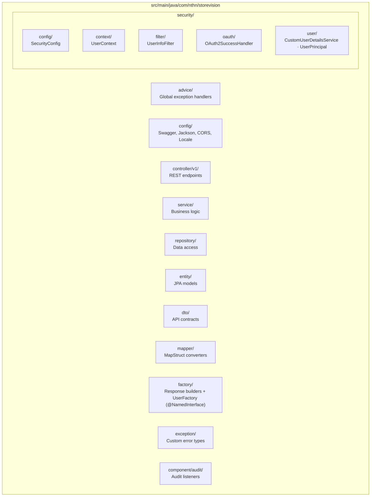
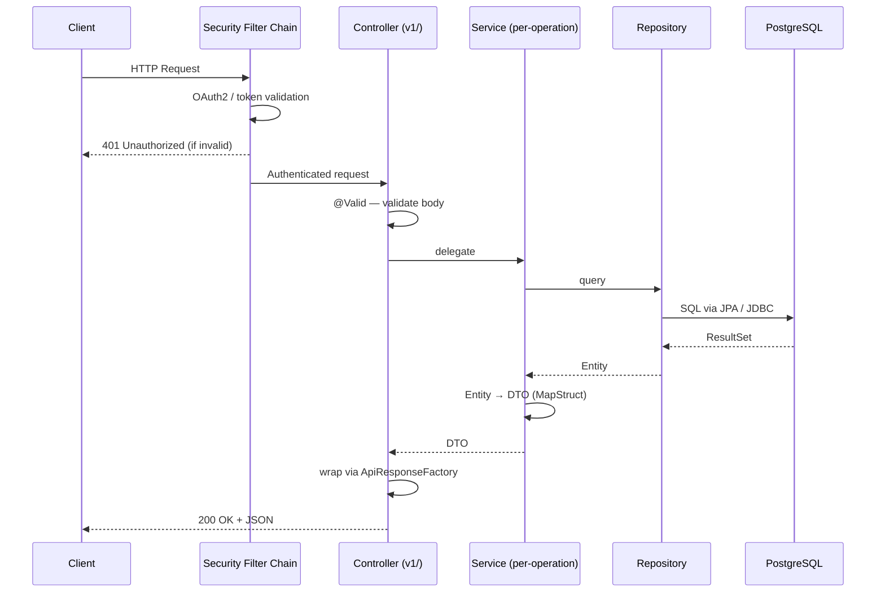
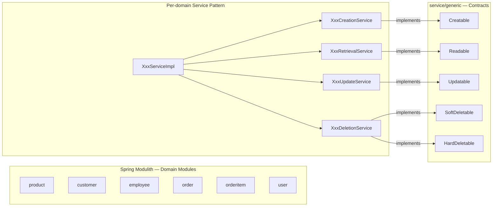
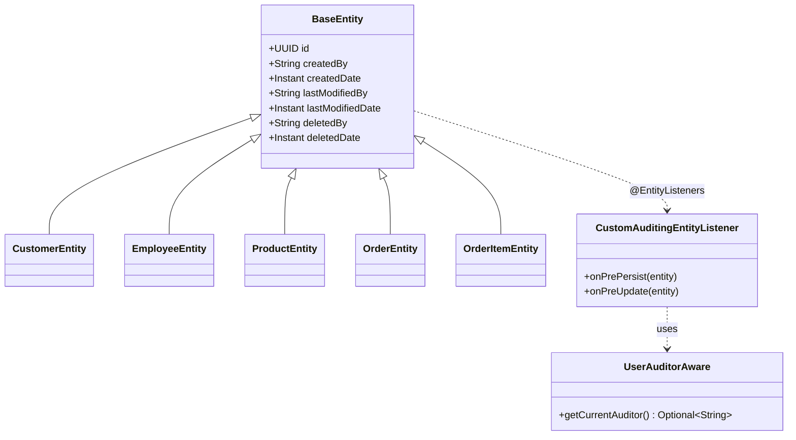

# StoreVision

A retail store management backend built with **Java 25** and **Spring Boot 4.0.6**, providing RESTful APIs for managing products, orders, customers, and employees.

## Features

- Product, Customer, Employee, Order & Order Item management (full CRUD)
- Google OAuth2 authentication via Spring Security
- Role-based access control with a custom security filter chain
- Soft-delete support with full audit trails (created/modified/deleted by + timestamp)
- Database schema versioning via Liquibase
- Modular architecture enforced by Spring Modulith
- API documentation via Swagger UI (SpringDoc OpenAPI 3)
- Internationalization (Vietnamese & English)

## Tech Stack

| Layer          | Technology                                          |
|----------------|-----------------------------------------------------|
| Language       | Java 25                                             |
| Framework      | Spring Boot 4.0.6 · Spring Modulith 2.0.6           |
| Data Access    | Spring Data JPA · Spring Data JDBC · Hibernate      |
| Database       | PostgreSQL · HikariCP · Liquibase 4.29.0            |
| Security       | Spring Security · OAuth2 (Google)                   |
| Mapping        | MapStruct                                           |
| Boilerplate    | Lombok                                              |
| Build          | Gradle 9.4.1                                        |
| Infrastructure | Docker · Docker Compose                             |
| API Docs       | SpringDoc OpenAPI 3.0.2 / Swagger UI                |
| Observability  | Spring Boot Actuator                                |

## Prerequisites

- Java 25+
- Docker & Docker Compose
- A Google OAuth2 application (Client ID & Secret)

## Getting Started

**1. Clone the repository**

```bash
git clone <repository-url>
cd StoreVision
```

**2. Start PostgreSQL**

```bash
docker compose up -d
```

**3. Configure environment variables**

| Variable                          | Description                        |
|-----------------------------------|------------------------------------|
| `DATASOURCE_URL`                  | PostgreSQL JDBC URL                |
| `DATASOURCE_MAX_POOL_SIZE`        | HikariCP max pool size             |
| `LIQUIBASE_CHANGE_LOG`            | Path to Liquibase master changelog |
| `LIQUIBASE_DEFAULT_SCHEMA`        | Default schema name                |
| `LIQUIBASE_CHANGE_LOG_TABLE`      | Liquibase tracking table name      |
| `LIQUIBASE_CHANGE_LOG_LOCK_TABLE` | Liquibase lock table name          |
| `GOOGLE_CLIENT_ID`                | Google OAuth2 client ID            |
| `GOOGLE_CLIENT_SECRET`            | Google OAuth2 client secret        |

**4. Run the application**

```bash
./gradlew bootRun
```

The API will be available at `http://localhost:8080/store-vision/api`.

## API Documentation

Swagger UI: `http://localhost:8080/store-vision/api/swagger-ui.html`

OpenAPI spec: `http://localhost:8080/store-vision/api/v3/api-docs`

## Build & Test

```bash
# Run tests
./gradlew test

# Build JAR (skip tests)
./gradlew build -x test

# Full clean build
./gradlew clean build

# Build Docker image
./gradlew bootBuildImage
```

## Project Structure



## Architecture

### Layered Request Flow



### Domain Module Structure



### Audit & Soft Delete



Each domain (Product, Customer, Employee, Order, OrderItem) has dedicated service classes per operation, all implementing generic interfaces from `service/generic/`. Spring Modulith enforces module boundaries at compiler and test time.

## License

Copyright © 2026 Nguyen Thi Hong Nhat. All rights reserved.
