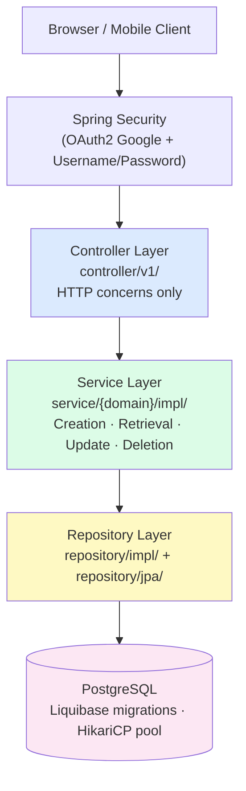
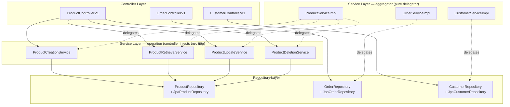
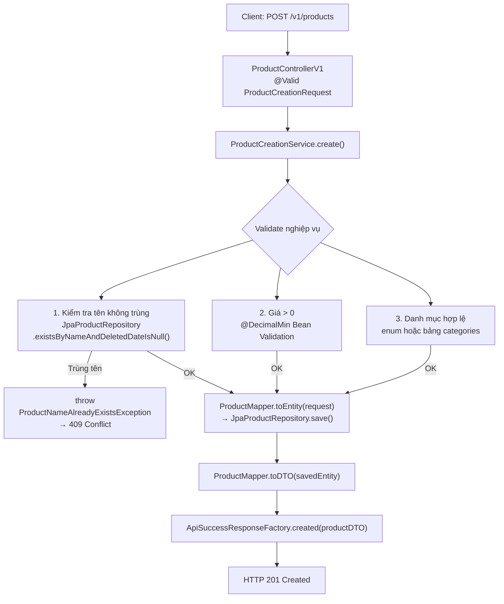
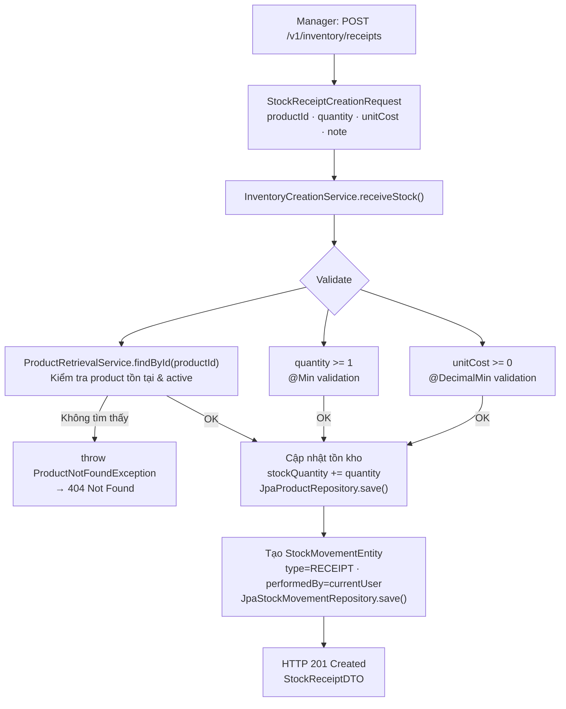
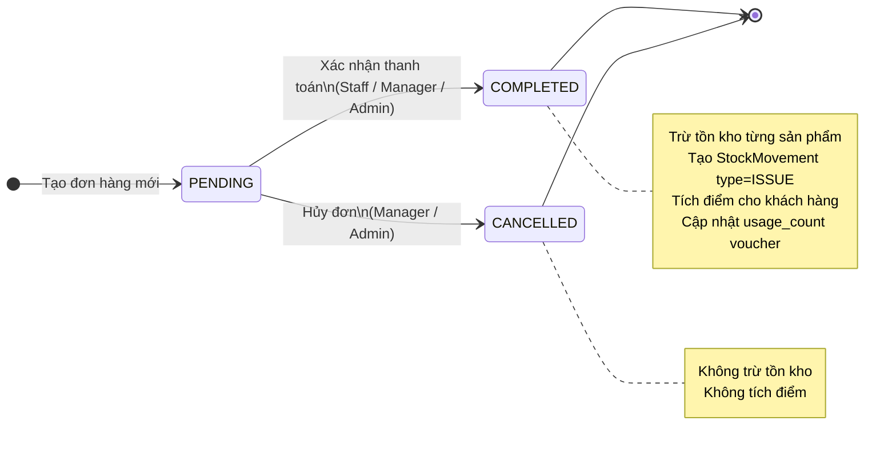
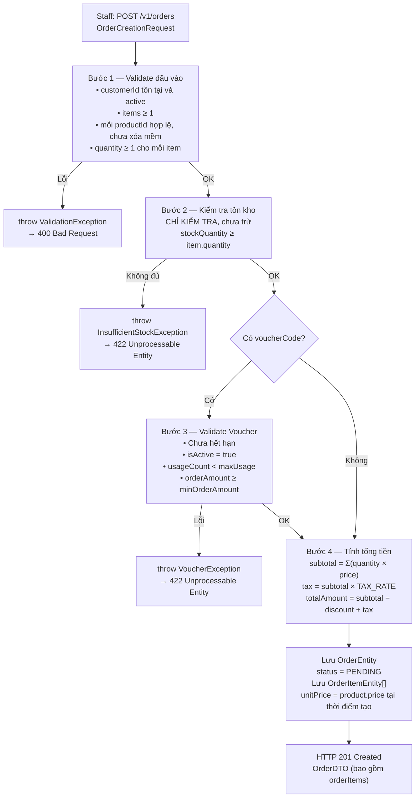
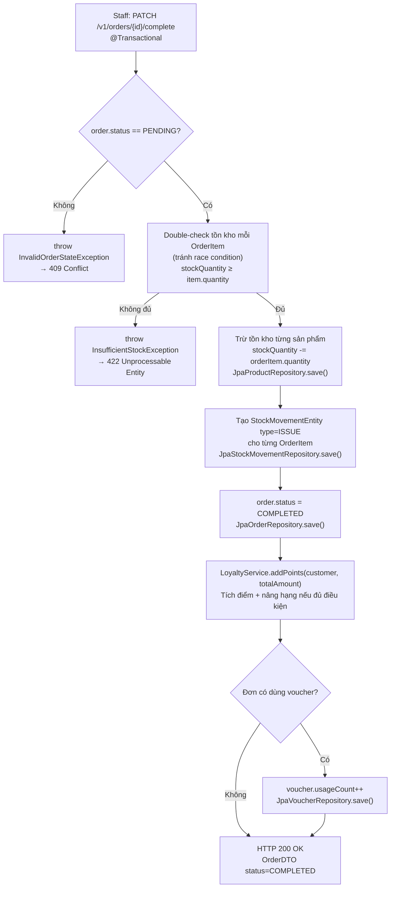
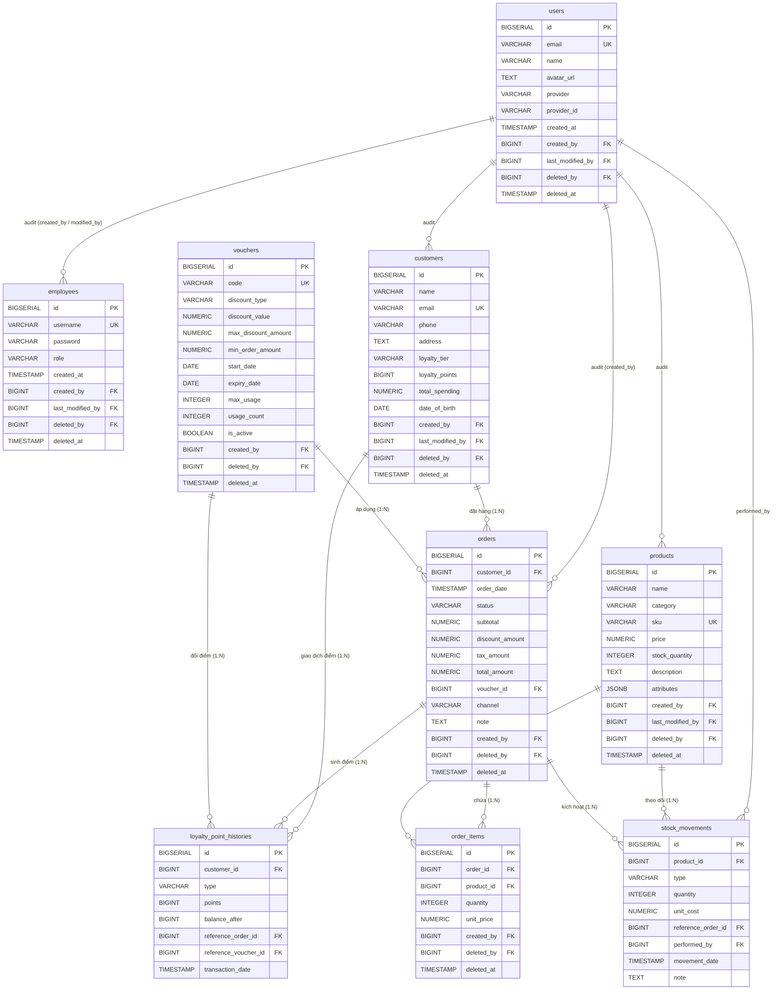

# Tài liệu Phân tích Thiết kế Hệ thống

**Dự án:** StoreVision – Hệ thống Quản lý Cửa hàng Bán lẻ  
**Phiên bản:** 1.0.0  
**Ngày lập:** 2026-06-03  
**Tác giả:** Nguyễn Thị Hồng Nhật  
**Trạng thái:** Đang triển khai  

---

## Mục lục

1. [Tổng quan dự án](#1-tổng-quan-dự-án)
2. [Cấu trúc kiến trúc hệ thống](#2-cấu-trúc-kiến-trúc-hệ-thống)
3. [Yêu cầu chức năng chi tiết](#3-yêu-cầu-chức-năng-chi-tiết)
4. [Các ràng buộc nghiệp vụ critical](#4-các-ràng-buộc-nghiệp-vụ-critical)
5. [Thiết kế cơ sở dữ liệu](#5-thiết-kế-cơ-sở-dữ-liệu)

---

## 1. Tổng quan dự án

### 1.1 Mục tiêu hệ thống

StoreVision là hệ thống quản lý cửa hàng bán lẻ toàn diện, được thiết kế theo kiến trúc **Layered Monolith** trên nền tảng **Spring Boot 4.0.6**. Hệ thống cung cấp:

- Quản lý danh mục sản phẩm, giá bán và tồn kho theo thời gian thực.
- Tiếp nhận và xử lý đơn hàng tại quầy (POS) lẫn qua kênh trực tuyến.
- Quản lý thông tin khách hàng và chương trình tích điểm thành viên.
- Quản lý nhân sự nội bộ với phân quyền theo vai trò (RBAC).
- Cung cấp báo cáo doanh thu, lợi nhuận, và thống kê bán hàng theo nhiều chiều thời gian.
- Ghi nhận đầy đủ audit trail cho mọi thao tác thay đổi dữ liệu.

### 1.2 Đối tượng sử dụng (Actors)

| Vai trò (Actor) | Enum trong hệ thống | Phạm vi quyền |
|---|---|---|
| **Quản trị viên (Admin)** | `EmployeeRole.ADMIN` | Toàn quyền: cấu hình hệ thống, quản lý tài khoản nhân viên, xem mọi báo cáo, xóa vĩnh viễn dữ liệu |
| **Quản lý cửa hàng (Manager)** | `EmployeeRole.MANAGER` | Quản lý sản phẩm, tồn kho, xem báo cáo, phê duyệt đơn hàng, quản lý khách hàng, không thể xóa vĩnh viễn |
| **Nhân viên bán hàng (Staff)** | `EmployeeRole.STAFF` | Tạo đơn hàng, tra cứu sản phẩm/khách hàng, xem tồn kho; không được xem báo cáo tài chính tổng hợp |
| **Khách hàng (Customer)** | Không phải employee | Tra cứu sản phẩm, xem lịch sử đơn hàng cá nhân, xem điểm tích lũy |

### 1.3 Nguyên tắc kiến trúc tổng thể



---

## 2. Cấu trúc kiến trúc hệ thống

### 2.1 Cấu trúc package thực tế

Dự án tổ chức theo **kiến trúc phân tầng (Layered Architecture)** — các package chia theo kỹ thuật (controller, service, repository…), bên trong mỗi tầng lại chia theo domain (customer, order, product…).

```
com.nthn.storevision
│
├── advice/                    ← Global exception handler, response interceptor
├── annotation/                ← @DeletedBy, @DeletedDate (custom audit annotations)
├── component/
│   └── audit/
│       └── impl/              ← CustomAuditingEntityListener, UserAuditorAware
├── config/                    ← JacksonConfig, LocaleConfig, SwaggerConfig, CorsConfig
├── constant/                  ← ApiPathConstants, OrderStatus, EmployeeRole, messages keys
├── controller/
│   └── v1/                    ← ProductControllerV1, OrderControllerV1, CustomerControllerV1…
├── dto/
│   ├── request/               ← ProductCreationRequest, OrderCreationRequest…
│   └── response/              ← ApiResponse, ApiSuccessResponse, ApiErrorResponse
├── entity/
│   ├── mapped/                ← BaseEntity<I> (audit fields)
│   └── ...                    ← ProductEntity, OrderEntity, CustomerEntity, EmployeeEntity…
├── exception/                 ← ApplicationException, EntityNotFoundException, EntityAccessException…
├── factory/                   ← ApiSuccessResponseFactory, ApiErrorResponseFactory
├── mapper/                    ← ProductMapper, OrderMapper, CustomerMapper… (MapStruct)
├── model/                     ← Product, Order, Customer, Employee… (domain interfaces)
├── repository/
│   ├── impl/                  ← ProductRepositoryImpl, OrderRepositoryImpl…
│   └── jpa/                   ← JpaProductRepository, JpaOrderRepository… (Spring Data JPA)
├── security/
│   ├── config/                ← SecurityConfig
│   ├── context/               ← UserContext
│   ├── filter/                ← UserInfoFilter
│   ├── oauth/                 ← OAuth2SuccessHandler
│   └── user/                  ← CustomUserDetailsService, UserPrincipal
├── service/
│   ├── common/                ← AbstractCreatable, AbstractReadable
│   ├── generic/               ← Creatable, Readable, Updatable, SoftDeletable, HardDeletable
│   ├── customer/
│   │   └── impl/              ← CustomerServiceImpl, CustomerCreationServiceImpl…
│   ├── employee/
│   │   └── impl/
│   ├── order/
│   │   └── impl/
│   ├── orderitem/
│   │   └── impl/
│   ├── product/
│   │   └── impl/
│   └── user/
│       └── impl/
├── util/                      ← PasswordUtil
└── validator/                 ← Custom Bean Validation validators
```

### 2.2 Kiến trúc tầng Service theo domain

Mỗi domain có một nhóm service riêng theo mẫu **Interface → Implementation**:

```
service/{domain}/
    {Domain}CreationService.java     ← interface, extends Creatable<E, I>
    {Domain}RetrievalService.java    ← interface, extends Readable<E, I>
    {Domain}UpdateService.java       ← interface, extends Updatable<E>           (bỏ nếu domain không có update)
    {Domain}DeletionService.java     ← interface, extends SoftDeletable<E,I> & HardDeletable<E,I>  (bỏ nếu không có delete)
    {Domain}Service.java             ← aggregator interface — TÙY CHỌN (xem quy tắc bên dưới)
    impl/
        {Domain}CreationServiceImpl.java
        {Domain}RetrievalServiceImpl.java
        {Domain}UpdateServiceImpl.java   (bỏ nếu không có update)
        {Domain}DeletionServiceImpl.java  ← chứa business rule của thao tác (vd: BR-P04)  (bỏ nếu không có delete)
        {Domain}ServiceImpl.java          ← aggregator impl, pure delegator  (bỏ nếu không cần aggregator)
```

> **Controller inject trực tiếp** vào các service cụ thể (`*CreationService`, `*RetrievalService`, …) — **không** đi qua aggregator `*Service`. Business rule gắn với một thao tác cụ thể phải được override trong `*OperationServiceImpl`, không đặt trong aggregator.
>
> **Quy tắc aggregator**: chỉ tạo `{Domain}Service` + `{Domain}ServiceImpl` khi domain thực sự cần điều phối liên-thao-tác (cross-operation orchestration). Domain chỉ có creation + retrieval (vd: **Inventory**) **không có aggregator** — controller inject trực tiếp 2 service cụ thể. Tạo aggregator khi không cần sẽ thêm tầng gián tiếp vô ích.



### 2.3 Nhóm chức năng theo domain

| Domain | Service package | Entity | Controller |
|---|---|---|---|
| Sản phẩm | `service/product/` | `ProductEntity` | `ProductControllerV1` |
| Đơn hàng | `service/order/` | `OrderEntity` | `OrderControllerV1` |
| Chi tiết đơn | `service/orderitem/` | `OrderItemEntity` | `OrderItemControllerV1` |
| Khách hàng | `service/customer/` | `CustomerEntity` | `CustomerControllerV1` |
| Nhân viên | `service/employee/` | `EmployeeEntity` | `EmployeeControllerV1` |
| Người dùng | `service/user/` | `UserEntity` | _(internal, no REST)_ |

---

## 3. Yêu cầu chức năng chi tiết

### 3.1 Mô-đun Quản lý Sản phẩm (`product`)

#### 3.1.1 Danh sách API

| Phương thức | Endpoint | Mô tả | Quyền |
|---|---|---|---|
| `POST` | `/store-vision/api/v1/products` | Thêm mới sản phẩm | ADMIN, MANAGER |
| `GET` | `/store-vision/api/v1/products` | Lấy danh sách sản phẩm (phân trang) | ADMIN, MANAGER, STAFF |
| `GET` | `/store-vision/api/v1/products/{id}` | Lấy chi tiết một sản phẩm | ADMIN, MANAGER, STAFF |
| `PUT` | `/store-vision/api/v1/products/{id}` | Cập nhật thông tin sản phẩm | ADMIN, MANAGER |
| `DELETE` | `/store-vision/api/v1/products/{id}` | Xóa mềm sản phẩm | ADMIN, MANAGER |
| `DELETE` | `/store-vision/api/v1/products/{id}/permanent` | Xóa vĩnh viễn | ADMIN |
| `PATCH` | `/store-vision/api/v1/products/{id}/restore` | Khôi phục sản phẩm đã xóa mềm | ADMIN, MANAGER |
| `GET` | `/store-vision/api/v1/products/search` | Tìm kiếm sản phẩm theo tên/danh mục | Tất cả |

#### 3.1.2 Luồng xử lý: Thêm mới sản phẩm



#### 3.1.3 Request/Response DTO

```java
// Request: POST /v1/products
public record ProductCreationRequest(
    @NotBlank String name,           // Tên sản phẩm, không được rỗng
    @NotBlank String category,       // Danh mục (vd: "Điện tử", "Thời trang")
    @NotNull @DecimalMin("0.01") BigDecimal price,  // Giá bán > 0
    @NotNull @Min(0) Integer stockQuantity,         // Số lượng tồn kho ban đầu >= 0
    String description,              // Mô tả sản phẩm (có thể null)
    String sku,                      // Mã SKU duy nhất (có thể null)
    Map<String, String> attributes   // Thuộc tính động: {"color":"Đỏ", "size":"XL"}
) {}

// Response: ProductDTO
public record ProductDTO(
    Long id,
    String name,
    String category,
    BigDecimal price,
    Integer stockQuantity,
    String description,
    String sku,
    Map<String, String> attributes,
    String createdBy,
    LocalDateTime createdDate,
    LocalDateTime lastModifiedDate
) {}
```

#### 3.1.4 Ràng buộc nghiệp vụ (Business Rules)

- **BR-P01**: Tên sản phẩm phải duy nhất trong cùng danh mục (kiểm tra `name + category`, bỏ qua bản ghi đã xóa mềm).
- **BR-P02**: Giá bán phải `> 0`. Giá không thể là `null`.
- **BR-P03**: `stockQuantity` phải `>= 0`. Không được nhập số âm.
- **BR-P04**: Khi xóa mềm sản phẩm đang có trong đơn hàng `PENDING`, hệ thống phải cảnh báo (Warning) nhưng vẫn cho phép xóa. Đơn hàng đang chờ xử lý sẽ giữ nguyên `unit_price` đã chốt. _(Kiểm tra được implement bằng cách override `markAsDeleted()` trong `ProductDeletionServiceImpl`, không đặt trong aggregator)_
- **BR-P05**: Thuộc tính động (`attributes`) được lưu dưới dạng JSONB trong PostgreSQL, không giới hạn tập khóa.

---

### 3.2 Mô-đun Quản lý Kho hàng (`inventory`)

#### 3.2.1 Danh sách API

| Phương thức | Endpoint | Mô tả | Quyền |
|---|---|---|---|
| `GET` | `/store-vision/api/v1/inventory` | Lấy danh sách tồn kho tất cả sản phẩm | ADMIN, MANAGER |
| `GET` | `/store-vision/api/v1/inventory/{productId}` | Tồn kho chi tiết một sản phẩm | ADMIN, MANAGER, STAFF |
| `POST` | `/store-vision/api/v1/inventory/receipts` | Tạo phiếu nhập hàng | ADMIN, MANAGER |
| `GET` | `/store-vision/api/v1/inventory/receipts` | Lịch sử nhập hàng (phân trang, lọc theo ngày) | ADMIN, MANAGER |
| `GET` | `/store-vision/api/v1/inventory/low-stock` | Danh sách sản phẩm sắp hết hàng | ADMIN, MANAGER |
| `GET` | `/store-vision/api/v1/inventory/movements/{productId}` | Lịch sử xuất/nhập kho theo sản phẩm | ADMIN, MANAGER |

#### 3.2.2 Luồng xử lý: Nhập hàng (Stock Receipt)



#### 3.2.3 Cơ chế cảnh báo Low-Stock

```
// Chạy định kỳ qua Spring Batch Job hoặc Scheduled Task
@Scheduled(cron = "0 0 8 * * *")  // Mỗi ngày 8:00 sáng
public void checkLowStockAlert() {
    List<ProductEntity> lowStock = jpaProductRepository
        .findByStockQuantityLessThanEqualAndDeletedDateIsNull(LOW_STOCK_THRESHOLD);
    // LOW_STOCK_THRESHOLD = 10 (cấu hình trong application.yml)
    
    lowStock.forEach(product -> {
        // Gửi thông báo nội bộ (Notification) cho MANAGER, ADMIN
        notificationService.sendLowStockAlert(product);
        log.warn("Low stock alert: product={}, remaining={}", product.getName(), product.getStockQuantity());
    });
}
```

#### 3.2.4 Ràng buộc nghiệp vụ

- **BR-I01**: Mỗi lần nhập/xuất kho phải ghi nhận `performed_by` (ID nhân viên thực hiện) — Audit Trail bắt buộc.
- **BR-I02**: Không được nhập số lượng âm. `quantity >= 1` cho mọi phiếu nhập.
- **BR-I03**: Không xóa được lịch sử kho (`stock_movements`) kể cả Admin. Chỉ được đọc.
- **BR-I04**: `LOW_STOCK_THRESHOLD` mặc định là 10, có thể cấu hình qua `application.yml` mà không cần restart.
- **BR-I05**: Khi hệ thống xử lý đơn hàng thành công, luồng xuất kho (`ISSUE` movement) phải được tạo tự động trong cùng transaction.

---

### 3.3 Mô-đun Quản lý Bán hàng & Hóa đơn (`order`)

#### 3.3.1 Danh sách API

| Phương thức | Endpoint | Mô tả | Quyền |
|---|---|---|---|
| `POST` | `/store-vision/api/v1/orders` | Tạo đơn hàng mới (POS / Online) | ADMIN, MANAGER, STAFF |
| `GET` | `/store-vision/api/v1/orders` | Lấy danh sách đơn hàng (phân trang, lọc trạng thái/ngày) | ADMIN, MANAGER |
| `GET` | `/store-vision/api/v1/orders/{id}` | Lấy chi tiết đơn hàng + danh sách sản phẩm | ADMIN, MANAGER, STAFF |
| `PATCH` | `/store-vision/api/v1/orders/{id}/complete` | Xác nhận thanh toán → COMPLETED | ADMIN, MANAGER, STAFF |
| `PATCH` | `/store-vision/api/v1/orders/{id}/cancel` | Hủy đơn hàng → CANCELLED | ADMIN, MANAGER |
| `GET` | `/store-vision/api/v1/orders/customer/{customerId}` | Lịch sử đơn hàng của một khách hàng | ADMIN, MANAGER |

#### 3.3.2 Trạng thái đơn hàng (State Machine)



- `PENDING → COMPLETED`: Nhân viên xác nhận thanh toán. Hệ thống trừ tồn kho, tạo stock movement `ISSUE`, tích điểm cho khách hàng.
- `PENDING → CANCELLED`: Manager/Admin hủy đơn. Không trừ tồn kho (vì chưa trừ ở bước PENDING). Không tích điểm.
- `COMPLETED / CANCELLED`: Trạng thái cuối. Không thể chuyển sang trạng thái khác.

#### 3.3.3 Luồng xử lý: Tạo đơn hàng



#### 3.3.4 Luồng xử lý: Xác nhận thanh toán (COMPLETE)



#### 3.3.5 Ràng buộc nghiệp vụ

- **BR-O01**: Đơn hàng không thể ở trạng thái `COMPLETED` nếu tồn kho tại thời điểm complete `< số lượng đặt`.
- **BR-O02**: Không thể hủy đơn hàng đã `COMPLETED`.
- **BR-O03**: `totalAmount` được tính lại phía server — không tin vào giá trị từ client request.
- **BR-O04**: `unitPrice` của mỗi `OrderItem` được chốt tại thời điểm tạo đơn. Sau đó, dù giá sản phẩm thay đổi, `unitPrice` trong `order_items` không đổi.
- **BR-O05**: Mỗi đơn hàng phải có ít nhất 1 `OrderItem`.

---

### 3.4 Mô-đun Khách hàng & Tích điểm (`customer`)

#### 3.4.1 Danh sách API

| Phương thức | Endpoint | Mô tả | Quyền |
|---|---|---|---|
| `POST` | `/store-vision/api/v1/customers` | Đăng ký/thêm khách hàng mới | ADMIN, MANAGER, STAFF |
| `GET` | `/store-vision/api/v1/customers` | Danh sách khách hàng (phân trang) | ADMIN, MANAGER |
| `GET` | `/store-vision/api/v1/customers/{id}` | Chi tiết khách hàng + điểm tích lũy + hạng | ADMIN, MANAGER, STAFF |
| `PUT` | `/store-vision/api/v1/customers/{id}` | Cập nhật thông tin khách hàng | ADMIN, MANAGER |
| `DELETE` | `/store-vision/api/v1/customers/{id}` | Xóa mềm khách hàng | ADMIN, MANAGER |
| `GET` | `/store-vision/api/v1/customers/{id}/orders` | Lịch sử đơn hàng của khách | ADMIN, MANAGER |
| `GET` | `/store-vision/api/v1/customers/{id}/loyalty` | Chi tiết tích điểm và hạng thành viên | Tất cả (chính khách hàng đó) |
| `POST` | `/store-vision/api/v1/customers/{id}/loyalty/redeem` | Đổi điểm lấy voucher giảm giá | ADMIN, MANAGER, STAFF |

#### 3.4.2 Chương trình hạng thành viên (Loyalty Tier)

| Hạng thành viên | Điều kiện (Tổng chi tiêu tích lũy) | Tỷ lệ tích điểm | Ưu đãi |
|---|---|---|---|
| **Đồng (Bronze)** | `0 – 4.999.999 VND` | 1 điểm / 10.000 VND | Không có ưu đãi đặc biệt |
| **Bạc (Silver)** | `5.000.000 – 19.999.999 VND` | 1,5 điểm / 10.000 VND | Ưu tiên hỗ trợ, giảm giá 5% ngày sinh nhật |
| **Vàng (Gold)** | `>= 20.000.000 VND` | 2 điểm / 10.000 VND | Giảm giá 10% ngày sinh nhật, tặng quà tháng |

#### 3.4.3 Luồng tích điểm sau khi đơn hàng COMPLETED

```java
// Trong LoyaltyServiceImpl.addPoints()
public void addPoints(final CustomerEntity customer, final BigDecimal orderAmount) {
    // Tính điểm dựa trên hạng hiện tại
    final double rate = switch (customer.getLoyaltyTier()) {
        case BRONZE -> 1.0 / 10_000;
        case SILVER -> 1.5 / 10_000;
        case GOLD   -> 2.0 / 10_000;
    };
    final long pointsEarned = Math.floor(orderAmount.doubleValue() * rate);
    
    customer.setLoyaltyPoints(customer.getLoyaltyPoints() + pointsEarned);
    customer.setTotalSpending(customer.getTotalSpending().add(orderAmount));
    
    // Tự động nâng hạng nếu đủ điều kiện
    upgradeIfEligible(customer);
    
    jpaCustomerRepository.save(customer);
    
    // Ghi lịch sử điểm
    pointHistoryRepository.save(PointHistory.earned(customer, pointsEarned, orderId));
}
```

#### 3.4.4 Ràng buộc nghiệp vụ

- **BR-C01**: Email khách hàng phải duy nhất trong toàn hệ thống (bao gồm cả bản ghi đã xóa mềm).
- **BR-C02**: Không thể xóa vĩnh viễn khách hàng còn đơn hàng `PENDING`. Phải hủy đơn trước.
- **BR-C03**: Điểm tích lũy không bao giờ được âm. Nếu đổi điểm vượt số dư, hệ thống từ chối.
- **BR-C04**: Hạng thành viên được tính dựa trên `total_spending` (tổng cộng dồn), không reset theo năm.
- **BR-C05**: Lịch sử tích/đổi điểm (`loyalty_point_histories`) không được xóa.

---

### 3.5 Mô-đun Báo cáo & Thống kê (`analytics`)

#### 3.5.1 Danh sách API

| Phương thức | Endpoint | Mô tả | Quyền |
|---|---|---|---|
| `GET` | `/store-vision/api/v1/analytics/revenue` | Thống kê doanh thu (tham số: `from`, `to`, `groupBy=day\|week\|month`) | ADMIN, MANAGER |
| `GET` | `/store-vision/api/v1/analytics/profit` | Thống kê lợi nhuận gộp (doanh thu - giá vốn) | ADMIN |
| `GET` | `/store-vision/api/v1/analytics/products/top-selling` | Top sản phẩm bán chạy (tham số: `limit=10`, `period=today\|week\|month`) | ADMIN, MANAGER |
| `GET` | `/store-vision/api/v1/analytics/products/slow-moving` | Sản phẩm bán chậm / tồn kho lâu | ADMIN, MANAGER |
| `GET` | `/store-vision/api/v1/analytics/customers/top-spending` | Top khách hàng theo tổng chi tiêu | ADMIN, MANAGER |
| `GET` | `/store-vision/api/v1/analytics/orders/summary` | Tổng hợp đơn hàng: tổng đơn, đơn thành công, đơn hủy | ADMIN, MANAGER |
| `GET` | `/store-vision/api/v1/analytics/inventory/valuation` | Định giá tồn kho hiện tại (giá vốn × số lượng) | ADMIN |

#### 3.5.2 Ràng buộc nghiệp vụ

- **BR-A01**: Chỉ tính doanh thu từ đơn hàng có `status = COMPLETED`.
- **BR-A02**: Khoảng thời gian `from` phải trước `to`. Nếu không truyền, mặc định lấy tháng hiện tại.
- **BR-A03**: Tất cả API báo cáo đều được cache trong Redis 5 phút để giảm tải database (sử dụng `@Cacheable`).
- **BR-A04**: STAFF không được phép gọi bất kỳ endpoint nào trong mô-đun `analytics`.

---

## 4. Các ràng buộc nghiệp vụ Critical

Đây là các quy tắc bắt buộc hệ thống phải kiểm tra tại **tầng Service** (không phải tầng Controller):

### 4.1 Kiểm tra tồn kho trước khi thanh toán

```java
// Trong OrderUpdateService.complete()
@Transactional
public OrderDTO complete(final Long orderId) {
    final OrderEntity order = findPendingOrderOrThrow(orderId);  // ném InvalidOrderStateException nếu không PENDING
    
    order.getOrderItems().forEach(item -> {
        final ProductEntity product = item.getProduct();
        if (product.getStockQuantity() < item.getQuantity()) {
            throw new InsufficientStockException(
                product.getName(),
                product.getStockQuantity(),
                item.getQuantity()
            );
        }
    });
    // Tiến hành trừ kho, hoàn tất đơn...
}
```

**Thông báo lỗi (i18n key):** `error.order.insufficient_stock`  
**HTTP Status:** `422 Unprocessable Entity`

---

### 4.2 Kiểm tra Voucher trước khi áp dụng

```java
// Trong VoucherValidationService.validate()
public void validate(final String voucherCode, final BigDecimal orderAmount) {
    final VoucherEntity voucher = jpaVoucherRepository.findByCode(voucherCode)
        .orElseThrow(() -> new VoucherNotFoundException(voucherCode));

    // BR-V01: Kiểm tra thời hạn
    if (voucher.getExpiryDate().isBefore(LocalDate.now())) {
        throw new VoucherExpiredException(voucherCode);
    }
    // BR-V02: Kiểm tra trạng thái kích hoạt
    if (!voucher.isActive()) {
        throw new VoucherInactiveException(voucherCode);
    }
    // BR-V03: Kiểm tra số lần sử dụng tối đa
    if (voucher.getUsageCount() >= voucher.getMaxUsage()) {
        throw new VoucherUsageLimitReachedException(voucherCode);
    }
    // BR-V04: Kiểm tra giá trị đơn hàng tối thiểu (nếu có)
    if (null != voucher.getMinOrderAmount() 
        && 0 > orderAmount.compareTo(voucher.getMinOrderAmount())) {
        throw new VoucherMinOrderAmountNotMetException(voucherCode, voucher.getMinOrderAmount());
    }
}
```

---

### 4.3 Audit Trail — Ghi nhận ID nhân viên thực hiện

Mọi thao tác nhập/xuất kho, xóa, và chỉnh sửa đều phải có dấu vết. Cơ chế:

```java
// BaseEntity tự động điền qua CustomAuditingEntityListener + UserAuditorAware
// Không cần set thủ công — chỉ cần save entity là có audit tự động

// Với stock movement — cần lưu explicit (vì là thao tác nghiệp vụ, không phải CRUD đơn thuần):
StockMovementEntity movement = StockMovementEntity.builder()
    .product(product)
    .type(StockMovementType.ISSUE)
    .quantity(orderItem.getQuantity())
    .performedBy(userContext.getCurrentUser())  // UserContext lấy từ SecurityContext
    .referenceOrderId(order.getId())
    .movementDate(LocalDateTime.now())
    .build();
jpaStockMovementRepository.save(movement);
```

---

### 4.4 Bảng tổng hợp toàn bộ Business Rules

| Mã BR | Mô-đun | Mô tả quy tắc | Tầng kiểm tra | HTTP Status khi vi phạm |
|---|---|---|---|---|
| BR-P01 | Product | Tên + danh mục sản phẩm phải duy nhất | Service | `409 Conflict` |
| BR-P02 | Product | Giá bán > 0 | Bean Validation | `400 Bad Request` |
| BR-P03 | Product | Tồn kho >= 0 | Bean Validation | `400 Bad Request` |
| BR-I01 | Inventory | Mỗi stock movement phải có `performed_by` | Service | `500` nếu thiếu (bug) |
| BR-I02 | Inventory | Số lượng nhập >= 1 | Bean Validation | `400 Bad Request` |
| BR-I03 | Inventory | Lịch sử kho không được xóa | Security (403) | `403 Forbidden` |
| BR-O01 | Order | Tồn kho đủ trước khi COMPLETE | Service | `422 Unprocessable Entity` |
| BR-O02 | Order | Không hủy đơn COMPLETED | Service | `409 Conflict` |
| BR-O03 | Order | `totalAmount` tính phía server | Service | (không expose lỗi) |
| BR-O04 | Order | `unitPrice` chốt lúc tạo đơn | Service | (không expose lỗi) |
| BR-V01 | Order | Voucher chưa hết hạn | Service | `422 Unprocessable Entity` |
| BR-V02 | Order | Voucher đang active | Service | `422 Unprocessable Entity` |
| BR-V03 | Order | Voucher chưa đạt giới hạn dùng | Service | `422 Unprocessable Entity` |
| BR-C01 | Customer | Email khách hàng duy nhất toàn hệ thống | Service | `409 Conflict` |
| BR-C02 | Customer | Không xóa KH còn đơn PENDING | Service | `409 Conflict` |
| BR-C03 | Customer | Điểm tích lũy không âm | Service | `422 Unprocessable Entity` |
| BR-A01 | Analytics | Chỉ tính đơn COMPLETED vào doanh thu | Repository (Query) | N/A |
| BR-A04 | Analytics | STAFF không truy cập analytics | Security | `403 Forbidden` |

---

## 5. Thiết kế cơ sở dữ liệu

### 5.1 Sơ đồ ERD (dạng text)



---

### 5.2 Định nghĩa chi tiết các bảng

#### Bảng: `users`

| Cột | Kiểu dữ liệu | PK | FK | Not Null | Unique | Mô tả |
|---|---|---|---|---|---|---|
| `id` | `BIGSERIAL` | ✓ | | ✓ | | Khóa chính |
| `email` | `VARCHAR(255)` | | | ✓ | ✓ | Email đăng nhập |
| `name` | `VARCHAR(255)` | | | ✓ | | Tên hiển thị |
| `avatar_url` | `TEXT` | | | | | Ảnh đại diện (OAuth2) |
| `provider` | `VARCHAR(50)` | | | ✓ | | `GOOGLE`, `LOCAL` |
| `provider_id` | `VARCHAR(255)` | | | | | ID từ Google OAuth2 |
| `created_at` | `TIMESTAMP` | | | ✓ | | Auto: Spring Auditing |
| `last_modified_at` | `TIMESTAMP` | | | ✓ | | Auto: Spring Auditing |
| `created_by` | `BIGINT` | | `users.id` | ✓ | | Auto: Spring Auditing |
| `last_modified_by` | `BIGINT` | | `users.id` | ✓ | | Auto: Spring Auditing |
| `deleted_by` | `BIGINT` | | `users.id` | | | Soft delete |
| `deleted_at` | `TIMESTAMP` | | | | | Soft delete |

---

#### Bảng: `employees`

| Cột | Kiểu dữ liệu | PK | FK | Not Null | Unique | Mô tả |
|---|---|---|---|---|---|---|
| `id` | `BIGSERIAL` | ✓ | | ✓ | | Khóa chính |
| `username` | `VARCHAR(100)` | | | ✓ | ✓ | Tên đăng nhập |
| `password` | `VARCHAR(255)` | | | ✓ | | Mật khẩu đã hash (BCrypt) |
| `role` | `VARCHAR(20)` | | | ✓ | | `ADMIN`, `MANAGER`, `STAFF` |
| `created_at` | `TIMESTAMP` | | | ✓ | | Auto: Spring Auditing |
| `last_modified_at` | `TIMESTAMP` | | | ✓ | | Auto: Spring Auditing |
| `created_by` | `BIGINT` | | `users.id` | ✓ | | Auto: Spring Auditing |
| `last_modified_by` | `BIGINT` | | `users.id` | ✓ | | Auto: Spring Auditing |
| `deleted_by` | `BIGINT` | | `users.id` | | | Soft delete |
| `deleted_at` | `TIMESTAMP` | | | | | Soft delete |

---

#### Bảng: `products`

| Cột | Kiểu dữ liệu | PK | FK | Not Null | Unique | Mô tả |
|---|---|---|---|---|---|---|
| `id` | `BIGSERIAL` | ✓ | | ✓ | | Khóa chính |
| `name` | `VARCHAR(255)` | | | ✓ | | Tên sản phẩm |
| `category` | `VARCHAR(100)` | | | | | Danh mục (vd: "Điện tử") |
| `sku` | `VARCHAR(100)` | | | | ✓ | Mã hàng hóa (nếu có) |
| `price` | `NUMERIC(15, 2)` | | | ✓ | | Giá bán hiện tại (VND) |
| `stock_quantity` | `INTEGER` | | | ✓ | | Tồn kho hiện tại, `>= 0` |
| `description` | `TEXT` | | | | | Mô tả chi tiết |
| `attributes` | `JSONB` | | | | | Thuộc tính động (màu, size…) |
| `created_at` | `TIMESTAMP` | | | ✓ | | Auto: Spring Auditing |
| `last_modified_at` | `TIMESTAMP` | | | ✓ | | Auto: Spring Auditing |
| `created_by` | `BIGINT` | | `users.id` | ✓ | | Auto: Spring Auditing |
| `last_modified_by` | `BIGINT` | | `users.id` | ✓ | | Auto: Spring Auditing |
| `deleted_by` | `BIGINT` | | `users.id` | | | Soft delete |
| `deleted_at` | `TIMESTAMP` | | | | | Soft delete |

**Index đề xuất:**
```sql
CREATE INDEX idx_products_category ON products(category) WHERE deleted_at IS NULL;
CREATE INDEX idx_products_name_category ON products(name, category) WHERE deleted_at IS NULL;
CREATE INDEX idx_products_stock ON products(stock_quantity) WHERE deleted_at IS NULL;
```

---

#### Bảng: `customers`

| Cột | Kiểu dữ liệu | PK | FK | Not Null | Unique | Mô tả |
|---|---|---|---|---|---|---|
| `id` | `BIGSERIAL` | ✓ | | ✓ | | Khóa chính |
| `name` | `VARCHAR(255)` | | | ✓ | | Họ và tên |
| `email` | `VARCHAR(255)` | | | ✓ | ✓ | Email (duy nhất toàn hệ thống) |
| `phone` | `VARCHAR(20)` | | | | | Số điện thoại |
| `address` | `TEXT` | | | | | Địa chỉ |
| `loyalty_tier` | `VARCHAR(20)` | | | ✓ | | `BRONZE`, `SILVER`, `GOLD` |
| `loyalty_points` | `BIGINT` | | | ✓ | | Điểm tích lũy hiện có, `>= 0` |
| `total_spending` | `NUMERIC(18, 2)` | | | ✓ | | Tổng chi tiêu cộng dồn |
| `date_of_birth` | `DATE` | | | | | Ngày sinh (tặng quà sinh nhật) |
| `created_at` | `TIMESTAMP` | | | ✓ | | Auto: Spring Auditing |
| `last_modified_at` | `TIMESTAMP` | | | ✓ | | Auto: Spring Auditing |
| `created_by` | `BIGINT` | | `users.id` | ✓ | | Auto: Spring Auditing |
| `last_modified_by` | `BIGINT` | | `users.id` | ✓ | | Auto: Spring Auditing |
| `deleted_by` | `BIGINT` | | `users.id` | | | Soft delete |
| `deleted_at` | `TIMESTAMP` | | | | | Soft delete |

---

#### Bảng: `orders`

| Cột | Kiểu dữ liệu | PK | FK | Not Null | Unique | Mô tả |
|---|---|---|---|---|---|---|
| `id` | `BIGSERIAL` | ✓ | | ✓ | | Khóa chính |
| `customer_id` | `BIGINT` | | `customers.id` | ✓ | | Khách hàng |
| `order_date` | `TIMESTAMP` | | | ✓ | | Thời điểm tạo đơn |
| `status` | `VARCHAR(20)` | | | ✓ | | `PENDING`, `COMPLETED`, `CANCELLED` |
| `subtotal` | `NUMERIC(15, 2)` | | | ✓ | | Tổng tiền hàng (trước giảm giá/thuế) |
| `discount_amount` | `NUMERIC(15, 2)` | | | ✓ | | Số tiền giảm (từ voucher) |
| `tax_amount` | `NUMERIC(15, 2)` | | | ✓ | | Tiền thuế |
| `total_amount` | `NUMERIC(15, 2)` | | | ✓ | | Thành tiền cuối |
| `voucher_id` | `BIGINT` | | `vouchers.id` | | | Voucher áp dụng (nullable) |
| `channel` | `VARCHAR(20)` | | | ✓ | | `POS` hoặc `ONLINE` |
| `note` | `TEXT` | | | | | Ghi chú |
| `created_at` | `TIMESTAMP` | | | ✓ | | Auto: Spring Auditing |
| `last_modified_at` | `TIMESTAMP` | | | ✓ | | Auto: Spring Auditing |
| `created_by` | `BIGINT` | | `users.id` | ✓ | | Nhân viên tạo đơn |
| `last_modified_by` | `BIGINT` | | `users.id` | ✓ | | Auto: Spring Auditing |
| `deleted_by` | `BIGINT` | | `users.id` | | | Soft delete |
| `deleted_at` | `TIMESTAMP` | | | | | Soft delete |

**Index đề xuất:**
```sql
CREATE INDEX idx_orders_customer ON orders(customer_id);
CREATE INDEX idx_orders_status ON orders(status);
CREATE INDEX idx_orders_date ON orders(order_date DESC);
CREATE INDEX idx_orders_analytics ON orders(order_date, status, total_amount) WHERE deleted_at IS NULL;
```

---

#### Bảng: `order_items`

| Cột | Kiểu dữ liệu | PK | FK | Not Null | Unique | Mô tả |
|---|---|---|---|---|---|---|
| `id` | `BIGSERIAL` | ✓ | | ✓ | | Khóa chính |
| `order_id` | `BIGINT` | | `orders.id` | ✓ | | Đơn hàng |
| `product_id` | `BIGINT` | | `products.id` | ✓ | | Sản phẩm |
| `quantity` | `INTEGER` | | | ✓ | | Số lượng, `>= 1` |
| `unit_price` | `NUMERIC(15, 2)` | | | ✓ | | Giá tại thời điểm tạo đơn (chốt) |
| `created_at` | `TIMESTAMP` | | | ✓ | | Auto: Spring Auditing |
| `last_modified_at` | `TIMESTAMP` | | | ✓ | | Auto: Spring Auditing |
| `created_by` | `BIGINT` | | `users.id` | ✓ | | Auto: Spring Auditing |
| `last_modified_by` | `BIGINT` | | `users.id` | ✓ | | Auto: Spring Auditing |
| `deleted_by` | `BIGINT` | | `users.id` | | | Soft delete |
| `deleted_at` | `TIMESTAMP` | | | | | Soft delete |

---

#### Bảng: `stock_movements` _(bảng mới cần tạo)_

| Cột | Kiểu dữ liệu | PK | FK | Not Null | Mô tả |
|---|---|---|---|---|---|
| `id` | `BIGSERIAL` | ✓ | | ✓ | Khóa chính |
| `product_id` | `BIGINT` | | `products.id` | ✓ | Sản phẩm liên quan |
| `type` | `VARCHAR(20)` | | | ✓ | `RECEIPT` (nhập), `ISSUE` (xuất đơn hàng), `ADJUSTMENT` (điều chỉnh) |
| `quantity` | `INTEGER` | | | ✓ | Số lượng thay đổi (luôn dương) |
| `unit_cost` | `NUMERIC(15, 2)` | | | | Giá vốn (chỉ điền khi RECEIPT) |
| `reference_order_id` | `BIGINT` | | `orders.id` | | Đơn hàng liên quan (nếu type=ISSUE) |
| `performed_by` | `BIGINT` | | `users.id` | ✓ | Nhân viên thực hiện (Audit Trail) |
| `movement_date` | `TIMESTAMP` | | | ✓ | Thời điểm thực hiện |
| `note` | `TEXT` | | | | Ghi chú |

> **Lưu ý:** Bảng này **không có soft delete** và **không có cột** `deleted_by`/`deleted_at`. Lịch sử kho là bất biến (immutable).

---

#### Bảng: `vouchers` _(bảng mới cần tạo)_

| Cột | Kiểu dữ liệu | PK | FK | Not Null | Unique | Mô tả |
|---|---|---|---|---|---|---|
| `id` | `BIGSERIAL` | ✓ | | ✓ | | Khóa chính |
| `code` | `VARCHAR(50)` | | | ✓ | ✓ | Mã voucher |
| `discount_type` | `VARCHAR(20)` | | | ✓ | | `PERCENTAGE` hoặc `FIXED_AMOUNT` |
| `discount_value` | `NUMERIC(10, 2)` | | | ✓ | | Giá trị giảm (% hoặc VND) |
| `max_discount_amount` | `NUMERIC(15, 2)` | | | | | Giảm tối đa (cho type PERCENTAGE) |
| `min_order_amount` | `NUMERIC(15, 2)` | | | | | Giá trị đơn hàng tối thiểu để áp dụng |
| `start_date` | `DATE` | | | ✓ | | Ngày bắt đầu hiệu lực |
| `expiry_date` | `DATE` | | | ✓ | | Ngày hết hạn |
| `max_usage` | `INTEGER` | | | ✓ | | Tổng số lần sử dụng tối đa |
| `usage_count` | `INTEGER` | | | ✓ | | Số lần đã dùng |
| `is_active` | `BOOLEAN` | | | ✓ | | Trạng thái kích hoạt |
| `created_at` | `TIMESTAMP` | | | ✓ | | Auto: Spring Auditing |
| `created_by` | `BIGINT` | | `users.id` | ✓ | | Auto: Spring Auditing |
| `last_modified_at` | `TIMESTAMP` | | | ✓ | | Auto: Spring Auditing |
| `last_modified_by` | `BIGINT` | | `users.id` | ✓ | | Auto: Spring Auditing |
| `deleted_by` | `BIGINT` | | `users.id` | | | Soft delete |
| `deleted_at` | `TIMESTAMP` | | | | | Soft delete |

---

#### Bảng: `loyalty_point_histories` _(bảng mới cần tạo)_

| Cột | Kiểu dữ liệu | PK | FK | Not Null | Mô tả |
|---|---|---|---|---|---|
| `id` | `BIGSERIAL` | ✓ | | ✓ | Khóa chính |
| `customer_id` | `BIGINT` | | `customers.id` | ✓ | Khách hàng |
| `type` | `VARCHAR(20)` | | | ✓ | `EARN` (tích điểm), `REDEEM` (đổi điểm) |
| `points` | `BIGINT` | | | ✓ | Số điểm thay đổi (luôn dương) |
| `balance_after` | `BIGINT` | | | ✓ | Số điểm còn lại sau giao dịch |
| `reference_order_id` | `BIGINT` | | `orders.id` | | Đơn hàng tạo ra điểm (cho EARN) |
| `reference_voucher_id` | `BIGINT` | | `vouchers.id` | | Voucher đổi được (cho REDEEM) |
| `transaction_date` | `TIMESTAMP` | | | ✓ | Thời điểm ghi điểm |

> **Lưu ý:** Bảng này **không có soft delete**. Lịch sử điểm là bất biến.

---

### 5.3 Liquibase Changeset — Thứ tự tạo bảng

```
db/changelog/
├── db.changelog-master.xml
├── 001-create-users-table.xml
├── 002-create-employees-table.xml
├── 003-create-customers-table.xml
├── 004-create-products-table.xml
├── 005-create-vouchers-table.xml
├── 006-create-orders-table.xml
├── 007-create-order-items-table.xml
├── 008-create-stock-movements-table.xml
└── 009-create-loyalty-point-histories-table.xml
```

> **Quy tắc Liquibase:** Thứ tự trên đảm bảo không vi phạm FK constraint. Bảng tham chiếu (được FK trỏ đến) phải tạo trước bảng tham chiếu (có FK).

---

### 5.4 Mapping Entity — Bảng tổng hợp

| Entity class | Bảng DB | Kế thừa BaseEntity | Ghi chú |
|---|---|---|---|
| `UserEntity` | `users` | Không (tự quản lý audit) | Dùng làm `createdBy/modifiedBy` cho tất cả |
| `EmployeeEntity` | `employees` | ✓ | Role: ADMIN/MANAGER/STAFF |
| `CustomerEntity` | `customers` | ✓ | Thêm loyalty fields |
| `ProductEntity` | `products` | ✓ | Thêm `attributes JSONB` |
| `OrderEntity` | `orders` | ✓ | State machine: PENDING→COMPLETED/CANCELLED |
| `OrderItemEntity` | `order_items` | ✓ | `unitPrice` chốt tại lúc tạo |
| `StockMovementEntity` _(mới)_ | `stock_movements` | Không (immutable) | Audit trail kho hàng |
| `VoucherEntity` _(mới)_ | `vouchers` | ✓ | Có soft delete |
| `LoyaltyPointHistoryEntity` _(mới)_ | `loyalty_point_histories` | Không (immutable) | Lịch sử điểm |

---

*Tài liệu này được tạo tự động dựa trên phân tích codebase StoreVision tại commit `081a894`. Cập nhật tài liệu mỗi khi có thay đổi schema hoặc nghiệp vụ lớn.*
