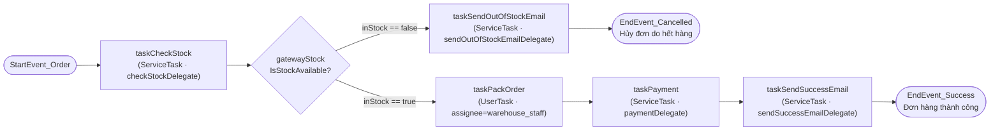

# Order Process – Business Logic (dựa trên `order-process.bpmn20.xml`)

> Nguồn: `src/main/resources/processes/order-process.bpmn20.xml` (process key
> `orderProcessingSystem`), engine Flowable OSS.
> Code liên quan hiện tại: `service/order/OrderProcessService(Impl)`,
> `workflow/delegate/*Delegate`, `controller/v1/OrderControllerV1`
> (`POST /orders/start`, `POST /orders/warehouse/tasks/{taskId}`,
> `GET /orders/warehouse/tasks`).
>
> Trạng thái hiện tại là **POC**: các delegate chỉ log và chứa `TODO`, chưa gọi
> vào domain service nào. Tài liệu này (1) mô tả luồng BPMN như đang được định
> nghĩa, (2) chỉ ra các khoảng trống nghiệp vụ trong bản POC, và (3) đề xuất
> business logic đầy đủ để lấp các khoảng trống đó, tuân theo kiến trúc
> layered (Controller → Service → Repository → Entity) và các quy ước ở
> `CLAUDE.md`.

## 1. Sơ đồ tiến trình



## 2. Node ↔ code hiện tại

| Node BPMN | Loại | Thành phần code hiện tại | Trạng thái |
|---|---|---|---|
| `StartEvent_Order` | Start Event | `OrderProcessServiceImpl#startOrderProcess(productId)` → `runtimeService.startProcessInstanceByKey("orderProcessingSystem", {productId})` | Chỉ nhận `productId`, chưa có `orderId` |
| `taskCheckStock` | Service Task | `CheckStockDelegate` | Hardcode `inStock = true`, không tra kho thật |
| `gatewayStock` | Exclusive Gateway | điều kiện `${inStock == true/false}` | OK, không cần business logic (gateway chỉ routing) |
| `taskSendOutOfStockEmail` | Service Task | `SendOutOfStockEmailDelegate` | Chỉ `log.info`, không gửi gì, không đổi trạng thái Order |
| `EndEvent_Cancelled` | End Event | — | Không đồng bộ với `OrderStatus` |
| `taskPackOrder` | User Task | `flowable:assignee="warehouse_staff"` (literal) | `completePacking(taskId)` chỉ gọi `taskService.complete`; `getWarehouseTasks()` lọc theo assignee literal |
| `taskPayment` | Service Task | `PaymentDelegate` | Chỉ `log.info`, đọc biến `orderId` **chưa từng được set** |
| `taskSendSuccessEmail` | Service Task | `SendSuccessEmailDelegate` | Chỉ `log.info`, đọc biến `orderId` **chưa từng được set** |
| `EndEvent_Success` | End Event | — | Không đồng bộ với `OrderStatus` |

## 3. Process variables

| Tên biến | Set bởi | Đọc bởi | Vấn đề |
|---|---|---|---|
| `productId` | `startOrderProcess` (start) | `CheckStockDelegate` | Chỉ 1 sản phẩm/instance — không khớp với `Order` có nhiều `OrderItem` |
| `inStock` | `CheckStockDelegate` | `gatewayStock` | Hardcode `true`, không phản ánh tồn kho thật |
| `stockStatus` | `CheckStockDelegate` | (không ai đọc) | Text tĩnh `"in stock"` |
| `orderId` | **không có node nào set** | `PaymentDelegate`, `SendSuccessEmailDelegate` | `execution.getVariable("orderId")` trả `null` → log sai, và nếu sau này logic thật cần `orderId` để cập nhật đơn thì sẽ `NullPointerException`/lookup fail |

Đây là gap quan trọng nhất cần sửa trước khi triển khai bất kỳ logic thật nào ở
`taskPayment`/`taskSendSuccessEmail`.

## 4. Đề xuất business logic theo từng bước

Nguyên tắc chung: **delegate chỉ orchestrate** (đọc/ghi process variable, gọi
service), **không chứa business rule** — rule thật nằm trong
`service/<domain>/impl/` đã có sẵn, giống nguyên tắc "aggregator là pure
delegator" trong `CLAUDE.md` mục 3.

### 4.1 Kích hoạt quy trình (Start)

- Bắt đầu process **sau khi** `OrderCreationService.createOrder(...)` đã
  persist `Order` + `OrderItem` thành công (không bắt đầu bằng `productId` rời
  rạc như hiện tại).
- `businessKey = orderId.toString()` — đúng chuẩn đã thống nhất trong
  `docs/workflow/flowable-oss-roadmap.md` mục 5, để tra cứu process theo đơn
  hàng qua `HistoryService`/`RuntimeService` sau này.
- Biến tối thiểu khi start: `orderId`, `items` (danh sách `{productId,
  quantity}` lấy từ `OrderItemDTO` của đơn) thay cho một `productId` đơn lẻ.
  Nếu muốn giữ contract 1-productId/instance thì phải làm rõ đây là quy trình
  theo dõi **từng `OrderItem`**, không phải theo `Order` — nên đổi tên process
  variable thành `orderItemId` cho đúng ngữ nghĩa và tránh nhầm với `Order`.

### 4.2 `taskCheckStock` (tái sử dụng BR-O01/BR-I)

- Gọi `InventoryRetrievalService.findInventoryByProductId(productId)` (đã có
  sẵn ở `service/inventory/`, trả `InventoryDTO` với `stockQuantity`) để lấy
  tồn kho thực tế thay vì hardcode. Đây chỉ là **gate sơ bộ** — gate cuối cùng
  và có tính quyết định vẫn là BR-O01 re-check bên trong `complete()` (xem
  4.6), vì tồn kho có thể đổi giữa lúc check và lúc thanh toán.
- `inStock = inventory.getStockQuantity() >= requestedQuantity` (cùng rule
  BR-O01 đang dùng khi tạo đơn, `ORM004`).
- `stockStatus` phản ánh đúng: `"available"` / `"insufficient"` — không dùng
  chuỗi tĩnh.
- Log theo chuẩn dự án: `log.debug("operation=checkStock orderId={}
  productId={} requested={} available={}", ...)`.

```java
// CheckStockDelegate — đề xuất
@Override
public void execute(final @NonNull DelegateExecution execution) {
    final Long productId = (Long) execution.getVariable("productId");
    final int requestedQty = (Integer) execution.getVariable("requestedQty");

    final InventoryDTO inventory = inventoryRetrievalService.findInventoryByProductId(productId);
    final boolean inStock = inventory.getStockQuantity() >= requestedQty;

    execution.setVariable("inStock", inStock);
    execution.setVariable("stockStatus", inStock ? "available" : "insufficient");
    log.debug(
        "operation=checkStock orderId={} productId={} requested={} available={}",
        execution.getVariable("orderId"), productId, requestedQty, inventory.getStockQuantity());
}
```

### 4.3 `gatewayStock`

- Giữ nguyên `${inStock == true}` / `${inStock == false}` — gateway không nên
  chứa business logic, chỉ routing theo biến do `taskCheckStock` set.

### 4.4 Nhánh hết hàng: `taskSendOutOfStockEmail` → `EndEvent_Cancelled`

- Gọi `OrderUpdateService.cancel(orderId)` — **không** tự viết lại logic hủy.
  `cancel()` đã tự bảo đảm `PENDING → CANCELLED` (BR-O02, ném
  `InvalidOrderStateException` nếu đơn không còn ở `PENDING`, ví dụ đã bị hủy
  hoặc hoàn tất trước đó) và **không đụng vào tồn kho/điểm thưởng**, đúng ngữ
  nghĩa "chưa từng trừ kho vì `taskPayment` chưa chạy tới". `transitionStatus(orderId,
  OrderStatus.CANCELLED)` cho kết quả tương đương (nó chỉ route sang cùng
  `cancelInternal`) nên dùng hàm nào cũng được — ưu tiên `cancel()` vì tên rõ
  ý định hơn tại call-site của delegate.
- Gọi `EntityNotFoundException`/`InvalidOrderStateException` từ `cancel()` cần
  được bắt trong delegate và ánh xạ thành **BPMN business error** (không để
  process instance crash) — vì đây là tình huống hợp lệ (ví dụ race: đơn đã bị
  admin hủy tay trong lúc quy trình đang chạy).
- Gửi thông báo qua tầng notification — **lưu ý**: `NotificationCreationService`
  hiện tại là `@FunctionalInterface` với **một** method duy nhất,
  `sendLowStockAlert(InventoryDTO)`, chuyên cho use-case cảnh báo tồn kho thấp
  (BR-I04). Nó **chưa** hỗ trợ gửi thông báo theo đơn hàng. Cần một trong hai
  hướng trước khi wiring thật:
  1. Bỏ `@FunctionalInterface`, thêm method mới
     `sendOrderNotification(OrderDTO order, NotificationType type)` vào cùng
     interface (đơn giản, tái dùng `NotificationEntity`/`NotificationMapper`
     đã có), hoặc
  2. Tạo interface riêng theo domain order (ví dụ
     `service/order/OrderNotificationService`) nếu muốn tách bounded context.
  Đề xuất hướng (1) vì hạ tầng lưu trữ/API đọc thông báo
  (`NotificationRetrievalService`, `GET /notifications`) đã dùng chung một
  `NotificationEntity`.
- Bổ sung `NotificationType.ORDER_OUT_OF_STOCK` (enum hiện chỉ có
  `LOW_STOCK_ALERT`) và message code mới theo registry hiện có, ví dụ `ORM007`
  — "Order cancelled due to insufficient stock (workflow)" — đăng ký trong
  `OrderMessageCode` + `messages.properties`/`messages-vi.properties`.
- `EndEvent_Cancelled` phải idempotent: nếu `Order` đã ở `CANCELLED` (retry do
  lỗi kỹ thuật), bắt `InvalidOrderStateException` và coi là no-op thành công,
  không throw lại.

### 4.5 Nhánh còn hàng: `taskPackOrder` (User Task)

- Thay `flowable:assignee="warehouse_staff"` (literal) bằng
  `flowable:candidateGroups` gắn với role kho thực tế (ví dụ nhóm ứng với
  `ROLE_STAFF`), để nhiều nhân viên kho có thể `claim`/`complete` thay vì một
  tài khoản cứng.
- `getWarehouseTasks()` phải lọc theo candidate group của **user hiện tại**
  (lấy từ `UserContext`/`SecurityContext`), không hardcode chuỗi
  `"warehouse_staff"` — đúng RBAC đã khai báo ở `SecurityConfig` cho
  `/orders/warehouse/tasks/**`.
- Khi `completePacking(taskId)` được gọi, set thêm variable `packedBy`
  (từ `UserContext`) và `packedAt` (`Instant.now()`) phục vụ audit — không set
  `deletedBy`/`deletedDate` kiểu `BaseEntity`, đây là audit riêng của workflow.

### 4.6 `taskPayment`

- Trước tiên **sửa gap `orderId`**: variable phải được set từ bước Start (4.1),
  không đọc một biến chưa từng tồn tại.
- Xác nhận thanh toán qua cổng thanh toán tương ứng kênh đơn hàng
  (`Order.channel`), hoặc — với COD — xác nhận qua nghiệp vụ nội bộ. Đây là
  bước duy nhất `PaymentDelegate` tự làm; **mọi thứ sau khi thanh toán được
  xác nhận đều giao cho `OrderUpdateService.complete(orderId)`** — không tự
  viết lại business logic:
  - `complete()` tự re-check BR-O01 (`verifyStockAvailability`, đọc trực tiếp
    tồn kho hiện tại của từng `OrderItem`, tổng hợp theo `productId` để không
    bỏ sót sản phẩm trùng) và ném `InsufficientStockException` nếu tồn kho
    biến mất giữa lúc `taskCheckStock` chạy và lúc thanh toán (race condition)
    — đây chính là điểm cần gắn **BPMN boundary error** trên `taskPayment`.
  - `complete()` tự trừ kho + ghi `StockMovement` loại `ISSUE` cho từng item
    (BR-I05), cộng điểm loyalty cho khách hàng, và tăng usage count của
    voucher nếu đơn có áp voucher — tất cả trong cùng transaction. Delegate
    không cần và không nên tự làm lại các bước này.
  - `complete()` yêu cầu đơn đang ở `PENDING` (`findPendingOrderOrThrow`),
    ném `InvalidOrderStateException` nếu không — cũng cần bắt và ánh xạ thành
    BPMN business error (đơn đã bị hủy/hoàn tất trước khi thanh toán xong).
- Delegate phải **idempotent theo `orderId`**: nếu Flowable retry job gọi lại
  sau khi `complete()` đã thành công ở lần trước, đơn không còn `PENDING` nữa
  → `complete()` sẽ ném `InvalidOrderStateException`; delegate cần phân biệt
  "đã COMPLETED rồi (an toàn, coi như thành công)" với các lỗi trạng thái khác.

```java
// PaymentDelegate — đề xuất
@Override
public void execute(final @NonNull DelegateExecution execution) {
    final Long orderId = (Long) execution.getVariable("orderId");
    log.info("operation=processPayment orderId={}", orderId);

    confirmPaymentWithGateway(orderId); // logic riêng của delegate: gọi cổng thanh toán

    try {
        orderUpdateService.complete(orderId); // BR-O01 recheck + trừ kho + loyalty + voucher
    } catch (final InsufficientStockException | InvalidOrderStateException businessError) {
        throw new BpmnError("PAYMENT_CONFIRMATION_FAILED", businessError.getMessage());
    }
}
```

### 4.7 `taskSendSuccessEmail`

- Cùng gap `orderId` như 4.6 — cần sửa trước.
- Dùng `OrderDTO` trả về từ `complete()` (có thể truyền qua process variable
  hoặc load lại bằng `OrderRetrievalService`) để lấy `customerId`/`totalAmount`
  cho nội dung thông báo.
- Áp dụng cùng hướng mở rộng `NotificationCreationService` đã nêu ở 4.4: thêm
  `NotificationType.ORDER_COMPLETED` + gọi
  `sendOrderNotification(order, NotificationType.ORDER_COMPLETED)`; có thể
  phát realtime qua `SseEmitterService` đã có sẵn thay vì chỉ log.

### 4.8 `EndEvent_Success` / `EndEvent_Cancelled`

- Ghi audit cuối cùng theo chuẩn `flowable-oss-roadmap.md`:
  `PROCESS_COMPLETED` / `PROCESS_CANCELLED` với `processInstanceId`,
  `businessKey` (=`orderId`), kết quả.

## 5. Đồng bộ trạng thái `Order` ↔ Process Instance

- Không cần thêm cột lưu `processInstanceId` trên `OrderEntity` nếu
  `businessKey = orderId` được dùng nhất quán — tra cứu process theo đơn hàng
  qua `HistoryService.createHistoricProcessInstanceQuery().processInstanceBusinessKey(orderId.toString())`.
- Nếu về sau cần hiển thị trạng thái workflow trên UI đơn hàng, bổ sung một
  endpoint đọc (không phải ghi) kiểu `GET /orders/{id}/workflow-status`, tuân
  thủ pattern Controller-interface + `V1` impl đã quy định.

## 6. Gap list — việc cần làm trước khi rời trạng thái POC

1. Set `orderId` khi start process (đang thiếu — mọi delegate đọc `orderId`
   hiện tại đều nhận `null`).
2. `CheckStockDelegate` gọi `InventoryRetrievalService.findInventoryByProductId`
   thay vì hardcode `inStock = true`.
3. `taskPackOrder` dùng `candidateGroups` theo role thay vì `assignee` literal;
   `getWarehouseTasks()` lọc theo user/role thực tế.
4. `taskSendOutOfStockEmail` gọi `OrderUpdateService.cancel(orderId)`;
   `taskPayment` gọi `OrderUpdateService.complete(orderId)` — **không** tự viết
   lại BR-O01 recheck/trừ kho/loyalty/voucher, các bước này đã có sẵn trong
   `complete()`.
5. Mở rộng `NotificationCreationService` (bỏ `@FunctionalInterface`, thêm
   method cho notification theo đơn hàng) trước khi wiring
   `taskSendOutOfStockEmail`/`taskSendSuccessEmail` vào thông báo thật; bổ
   sung `NotificationType.ORDER_OUT_OF_STOCK`/`ORDER_COMPLETED`.
6. `taskPayment` cần bắt `InsufficientStockException`/`InvalidOrderStateException`
   từ `complete()` và ném `BpmnError` (boundary error) thay vì để process
   instance crash; xử lý idempotent khi đơn đã `COMPLETED` từ lần retry trước.
7. Đăng ký message code mới (ví dụ `ORM007`) nếu thêm lý do hủy đơn mới, theo
   registry ở `CLAUDE.md` mục 6.
8. Unit test cho từng delegate (mock `DelegateExecution`,
   `InventoryRetrievalService`, `OrderUpdateService`) + integration test theo
   kế hoạch Sprint 4 của `flowable-oss-roadmap.md`.

## 7. Testing đề xuất

- Unit test: mock `DelegateExecution`, `InventoryRetrievalService`,
  `OrderUpdateService`, `NotificationCreationService` cho từng delegate; đặt
  tại `test/java/.../workflow/delegate/`, naming
  `execute_givenInsufficientStock_thenSetsInStockFalse` theo chuẩn dự án.
- Integration test: dùng Flowable test extension + Testcontainers PostgreSQL
  để chạy hết nhánh happy-path (`EndEvent_Success`) và nhánh hết hàng
  (`EndEvent_Cancelled`), verify `OrderStatus` cuối cùng khớp với nhánh BPMN đã
  đi qua.
